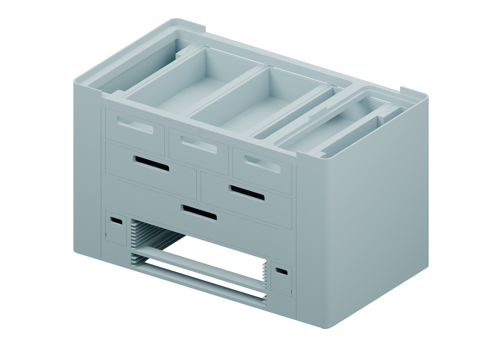

# StackNest · 叠序

A modular storage base for AMS 2 Pro and AMS HT: two plate-storage layers, three drawer layers and a split device top.



**This is an unprinted digital prototype.** Geometry checks have passed; generic FDM checks found local thin-wall / thin-skin failures; device fit, slicing, load capacity and physical assembly have not been validated. The drawings show the model, not a finished print.

## Model files

Browse the [models by layer](models/): 58 STL parts, six geometry-only 3MF assemblies, per-layer GLBs and the complete assembly. Individual files are stored directly in this repository.

## Contents

- 30 mm three-slot plate layer with integral front closures
- 60 mm eight-slot plate layer with two small side bins
- 60 mm single-, double- and triple-drawer layers
- Split device top with a stepped opening for AMS HT
- Full-length plate ledges, integrated rear stops and removable rear seam keys

Complete envelope: **495 × 287 × 299 mm**, including feet. The complete arrangement has 58 parts, 11 plate positions, six main drawers and two side bins.

## Build from source

Install Python 3.12+ and [uv](https://docs.astral.sh/uv/).

```sh
uv sync --frozen
uv run python tools/build.py
uv run python tools/verify.py
uv run python tools/package.py
```

The model is constructed from analytic primitives. Building it does not read STL, GLB, PLY, 3MF, vendor meshes or earlier project revisions. Generated STL units are millimetres. Generated 3MF files contain assembly geometry only, with no printer or support settings.

Source: `src/stacknest/`. Outputs: `output/model/` and `dist/stacknest/`.

## Assembly guides

Each layer has its own Chinese and English PDF in [docs/pdf](docs/pdf). Match the part ID printed in the guide to the filename prefix in the package. The top is a separate sixth booklet. The combined manuals are supplementary.

## Rendering and documentation

```sh
uv sync --frozen --group docs
uv run python tools/render.py
blender --background --factory-startup --python tools/render_blender.py
uv run --group docs python tools/manual.py
uv run --group docs python tools/layer_manuals.py
```

`render.py` creates the exploded scenes and camera metadata using the optional text-to-cad `cad` CLI. `render_blender.py` renders the final images with flat face normals and large area lights. The PDF scripts require CJK TrueType fonts; set `STACKNEST_FONT_REGULAR` and `STACKNEST_FONT_BOLD` when not using the default macOS fonts. Fonts are not redistributed.

## Validation and limits

The build checks all 1,653 pairs of assembled parts, drawer travel, plate support and selected joint paths. `verify.py` checks closed solids, counts, dimensions and absence of external geometry inputs. Optional `tools/check_printing.py` uses text-to-cad for generic PETG/FDM checks: 0.4 mm nozzle, 0.2 mm layers, 256 × 256 × 260 mm build volume. Generic checks report thin-wall errors on the single-drawer rear half and thin-skin errors on the three small main drawers, plus overhang, bridge and thin-edge warnings. The two single-drawer halves have no planar bed contact in the current candidate poses; the rear half also exceeds the 260 mm build height. Those poses must be revised before slicing. These checks are not a tested print profile or load rating.

Rear beams and seam keys are removable and are not captive. Remove devices and the upper layer before servicing drawers. Verify actual device feet, underside clearance, ventilation, cables and stability before placing equipment on the stack.

## Design basis

从社区已有模型的实践为参考设计基础。

The design is based on practical experience with existing community models. The current model builds from parametric geometry without external model meshes. See [design basis](docs/provenance.md).
