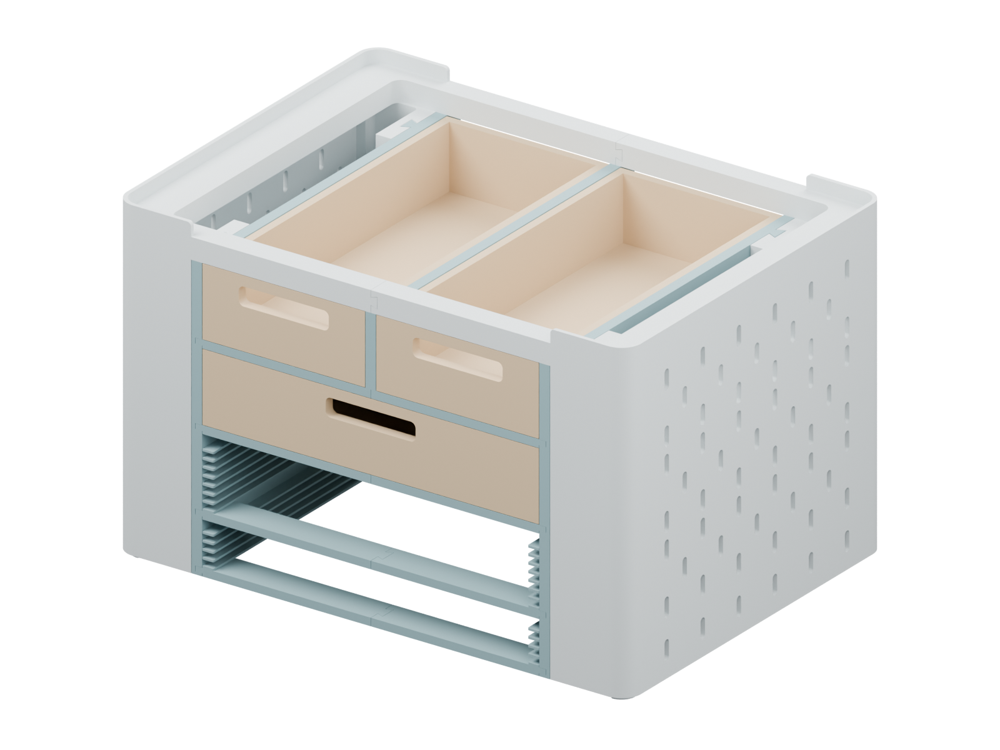
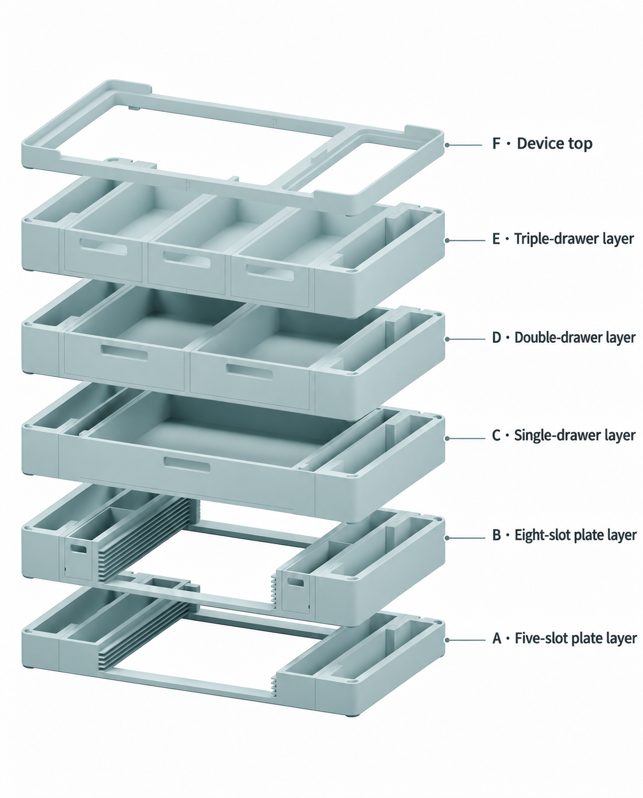
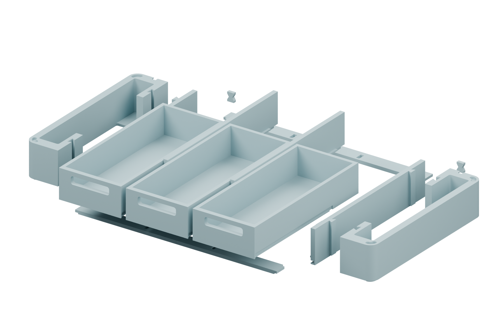

# StackNest · 叠序

**Build plate compatibility: all current five- and eight-slot racks are designed only for Bambu plates in the 256 × 256 mm printable-area class: A1, P1P, P1S, P2S, X1, X1 Carbon (X1C), X1E and X2D.** A1 mini and H-series plates are not supported. 256 × 256 mm describes the printable area, not the full steel-sheet outline. Check third-party plate outlines and thickness separately; physical fit has not been tested.

A modular storage base for AMS 2 Pro, with or without AMS HT: stackable plate-storage layers, drawers and a matching device top.

| AMS 2 Pro + HT | AMS 2 Pro only |
| --- | --- |
| [](models/ams2pro+ht/) | [](models/ams2pro/) |
| 495 × 287 mm · Single / double / triple drawers | 399 × 287 mm · Single / double drawers |

Both sets support plain or pegboard ends. Click a preview to browse its models.

[中文](README.zh-CN.md) · [Models](models/) · [Assembly guides](docs/pdf/)

Images show the actual base geometry. Equipment renders are pending the correct device models.

**This is an unprinted digital prototype.** Geometry checks have passed; the original HT set still has local thin-wall / thin-skin failures; the new AMS-only exports pass generic FDM checks; device fit, slicing, load capacity and physical assembly have not been validated. The drawings show the model, not a finished print.

## Model files

The [HT set](models/ams2pro+ht/) has 58 assembly parts. The [AMS-only set](models/ams2pro/) has 47. Both share the [common ends and keys](models/common/). STL, geometry-only 3MF and GLB files are stored directly in the repository.

## Two widths, shared ends

| | AMS 2 Pro + HT | AMS 2 Pro only |
| --- | --- | --- |
| Footprint | 495 × 287 mm | 399 × 287 mm |
| Plate layers | Five / eight slots; eight-slot layer includes two side bins | Five / eight slots, no side bins |
| Drawer middle | One, two or three drawers | **One or two drawers; no three-drawer option** |
| Complete example | 13 plates, six main drawers, two bins; 309 mm high | 13 plates, three main drawers; 249 mm high |
| Ends and keys | Shared by layer height | Same parts, right side moved inward |

The AMS-only set is 96 mm narrower. It retains the nominal 258 mm plate width, 1 mm play on each side and the original 60 mm end frames. That makes its base slightly wider than the [372 mm AMS 2 Pro](https://store.bblcdn.com/s3/default/02bc9c24b207476a9608a314b8039509/AMS_2_Pro-EN.pdf). Its top has a single device opening, without an HT cutout.


[AMS-only files and layer assembly](models/ams2pro/) · [Plain ends](docs/images/no-ht-plain.png)

### Common ends: plain or pegboard

**Choose the ends, then the middle.** Use 40 mm ends for the low plate layer and 60 mm ends for tall plate or drawer layers. The same-height end frames and rear keys work in both widths. Middle sections and tops are width-specific; do not stack a 399 mm layer on a 495 mm layer. Left and right ends remain distinct because the right-front socket has extra lateral clearance.


Pegboard ends retain the original rounded outline, locating feet, sockets, dovetails and rear key pockets. Only the outer panel changes. Either side can be replaced independently.

- SKÅDIS-style vertical slots: **5 × 15 mm, R2.5, 5 mm panel**.
- **40 mm** repeat along each row/column; alternate rows offset **20 × 20 mm**.
- The 40 mm end has six slots in one row. The 60 mm end has 17 slots across three rows, including a 40 mm vertical pair for two-point accessories.
- At least **20 mm rear clearance** behind each slot. Each layer is a separate mounting zone; the pattern is not continuous across seams.
- Print the [80 × 80 mm fit coupon](models/common/pegboard_fit_coupon.stl) before a full end. Hook fit and payload have not been physically tested.

[Common parts, dimensions and fitting notes](models/common/) · [HT set with pegboard ends](docs/images/wide-pegboard.png)

## Stack, combine and expand (HT examples)

Each storage function lives in its own layer. The end frames connect the layers above and below; the centre holds plate ledges or drawers; one device top finishes the stack. Start with one layer and add storage as needed.

- **Stackable:** all layers share curved locating feet and matching sockets. Lower a layer vertically, then insert two rear keys at each seam to resist vertical separation. The keys can slide out rearward; they are not captive latches.
- **Mix and match:** choose, reorder or repeat complete five-slot, eight-slot, single-, double- and triple-drawer layers. Keep every front opening facing forward and the device top uppermost.
- **Expand incrementally:** add plate layers for more plates or drawer layers for more categories. Retain the existing layers and print the new layer plus two keys for each added seam. The five-slot layer package does not include seam keys; add a pair of common keys when using it above another layer. Omit the lower seam keys on whichever layer is used as the base.
- **Replace individual parts:** frames, carriers, beams, drawers and the top are separate parts. Unload the devices and remove upper layers before changing a module. Change drawer layouts as complete layers: a wide drawer does not fit the double-drawer guides.

The 40 mm and 60 mm figures are layer increments. With the top fitted, overall base height is **the sum of layer heights + 29 mm** (26 mm top and 3 mm feet), excluding devices. Width and depth remain 495 × 287 mm.

| Example, bottom to top | Capacity | Base height |
| --- | --- | ---: |
| Five-slot layer → top | 5 plates | 69 mm |
| Five-slot layer → double-drawer layer → top | 5 plates, 2 main drawers | 129 mm |
| Eight-slot layer × 2 → triple-drawer layer → top | 16 plates, 3 main drawers, 4 side bins | 209 mm |
| Single → double → triple-drawer layer → top | 6 main drawers | 209 mm |
| Full arrangement A → B → C → D → E → F | 13 plates, 6 main drawers, 2 side bins | 309 mm |


The full HT stack separated into layers:



From top to bottom in the image (click a layer name for its models):

| Layer | Name | Purpose |
| --- | --- | --- |
| F | [Device top](models/ams2pro+ht/06-device-top/) | Supports AMS 2 Pro + AMS HT |
| E | [Triple-drawer layer](models/ams2pro+ht/05-triple-drawer-layer/) | Three separate drawers for small parts |
| D | [Double-drawer layer](models/ams2pro+ht/04-double-drawer-layer/) | Two separate drawers for tools and spares |
| C | [Single-drawer layer](models/ams2pro+ht/03-single-drawer-layer/) | One wide drawer for longer tools |
| B | [Eight-slot plate layer](models/ams2pro+ht/02-eight-slot-plate-layer/) | Stores 8 plates, with one small bin on each side |
| A | [Five-slot plate layer](models/ams2pro+ht/01-five-slot-plate-layer/) | Stores 5 frequently used plates |

This is the full example stack. Choose only the storage layers you need; always keep the device top uppermost.

Reusable interfaces do not imply unlimited stacking. No maximum layer count or load rating has been established. Check stability, clearance and actual fit for each configuration. The two widths use separate middle sections and tops. Do not mix widths within a stack. Arbitrary widths and side-by-side joints are not included.

## A closer look at each HT layer

### A · 40 mm five-slot plate layer

The 40 mm layer holds 5 plates at 6 mm pitch, allowing plates up to 1.5 mm thick and 7 mm clearance above the top plate. A sixth slot would require at least 46 mm at this spacing. The old 30 mm three-slot version is retired; replace its low end frames and carriers together when upgrading.

A low-profile starting point for five frequently used plates. Continuous side ledges support the plate edges up to rigid rear stops. Front closures are integral with the carriers, so no separate blanking plates are needed. Six parts: two end frames, two carriers and front/rear beams. Insert plates from the front; lift about 1 mm before pulling them out.


[Models and parts](models/ams2pro+ht/01-five-slot-plate-layer/) · [Assembly guide](docs/pdf/01-five-slot-plate-layer-assembly-en.pdf)

### B · 60 mm eight-slot plate layer

Eight plate positions in the same footprint, plus two small side bins for tools and loose parts. The ledges and rigid rear stops locate each plate; the stops are not spring clips. Side bins travel about 60 mm. Remove the layer above, then lift a bin about 12 mm at its stop to take it out. Ten parts, including the two keys for the seam below this layer.


[Models and parts](models/ams2pro+ht/02-eight-slot-plate-layer/) · [Assembly guide](docs/pdf/02-eight-slot-plate-layer-assembly-en.pdf)

### C · 60 mm single-drawer layer

One wide drawer for longer tools or items that do not fit narrow compartments. Its front and rear halves join with a transverse sliding dovetail. The floor is 2 mm solid, with local reinforcement retained around the seam. Join the drawer first, assemble the frame, then insert it along the guides. Travel is about 180 mm; lift 7 mm at the stop for removal. Ten parts, including two seam keys.


[Models and parts](models/ams2pro+ht/03-single-drawer-layer/) · [Assembly guide](docs/pdf/03-single-drawer-layer-assembly-en.pdf)

### D · 60 mm double-drawer layer

Two independent drawers and one divider separate tools from spare parts. Each front/rear beam has two joined halves; the divider drops into locating slots in both beams. Each drawer is one piece with a 2 mm solid floor, its own guides and a stop at about 180 mm travel. Thirteen parts, including two seam keys.


[Models and parts](models/ams2pro+ht/04-double-drawer-layer/) · [Assembly guide](docs/pdf/04-double-drawer-layer-assembly-en.pdf)

### E · 60 mm triple-drawer layer

Three narrow drawers and two dividers provide separate homes for nozzles, small hardware or filament accessories. All drawers move independently and have 2 mm solid floors. Seat both ends of each divider before testing the drawers one at a time. Fifteen parts, including two seam keys. The single-, double- and triple-drawer layers share the same height and stacking interfaces.



[Models and parts](models/ams2pro+ht/05-triple-drawer-layer/) · [Assembly guide](docs/pdf/05-triple-drawer-layer-assembly-en.pdf)

### F · AMS 2 Pro + AMS HT device top

Four parts: two top halves and two rear locking keys. Slide the front and rear dovetails together with both halves level, then lower the four curved feet into the uppermost layer. The left area is intended for AMS 2 Pro; the right stepped opening is for AMS HT. Short perimeter lips provide location. Move this same top to the new uppermost layer when expanding the stack.


[Models and parts](models/ams2pro+ht/06-device-top/) · [Assembly guide](docs/pdf/06-device-top-assembly-en.pdf)

Check actual device feet, underside, air inlets, tubing and lid-opening clearance before use. The top and its rendering do not establish physical compatibility.

## Build from source

Install Python 3.12+ and [uv](https://docs.astral.sh/uv/).

```sh
uv sync --frozen
uv run python tools/build.py
uv run python tools/verify.py
uv run python tools/package.py
cad run tools/build_variants.py
uv run python tools/verify_variants.py
uv run python tools/check_variants.py
```

The model is constructed from analytic primitives. Building it does not read STL, GLB, PLY, 3MF, vendor meshes or earlier project revisions. Generated STL units are millimetres. Generated 3MF files contain assembly geometry only, with no printer or support settings.

Source: `src/stacknest/`. Outputs: `output/model/` and `models/ams2pro+ht/`.

## Assembly guides

Each HT layer has its own Chinese and English PDF in [docs/pdf](docs/pdf). Match the part ID printed in the guide to the filename prefix in the package. The top is a separate sixth booklet. The combined manuals are supplementary.

## Rendering and documentation

```sh
uv sync --frozen --group docs
uv run python tools/render.py
cad run tools/render_blender.py
uv run python tools/render_variants.py
uv run python tools/model_previews.py
uv run python tools/number_compact_parts.py
cad run tools/render_blender.py --jobs output/numbered/jobs.json
cad run tools/render_blender.py --jobs output/previews/jobs.json
cad run tools/render_blender.py --jobs output/variants/render-jobs.json
uv run --group docs python tools/manual.py
uv run --group docs python tools/layer_manuals.py
```

`render.py` creates the exploded scenes and camera metadata using the optional text-to-cad `cad` CLI. `render_blender.py` renders the final images with flat face normals and large area lights. The PDF scripts require CJK TrueType fonts; set `STACKNEST_FONT_REGULAR` and `STACKNEST_FONT_BOLD` when not using the default macOS fonts. Fonts are not redistributed.

## Validation and limits

The build checks all 1,653 pairs of assembled parts, drawer travel, plate support and selected joint paths. `verify.py` checks closed solids, counts, dimensions and absence of external geometry inputs. Optional `tools/check_printing.py` uses text-to-cad for generic PETG/FDM checks: 0.4 mm nozzle, 0.2 mm layers, 256 × 256 × 260 mm build volume. Generic checks report thin-wall errors on the single-drawer rear half and thin-skin errors on the three small main drawers, plus overhang, bridge and thin-edge warnings. The two single-drawer halves have no planar bed contact in the current candidate poses; the rear half also exceeds the 260 mm build height. Those poses must be revised before slicing. These checks are not a tested print profile or load rating.

Rear beams and seam keys are removable and are not captive. Remove devices and the upper layer before servicing drawers. Verify actual device feet, underside clearance, ventilation, cables and stability before placing equipment on the stack.

## Design basis

The design is based on practical experience with existing community models. The current model builds from parametric geometry without external model meshes. See [design basis](docs/provenance.md).

The AMS-only export passes 1,081 complete-assembly pairs, 1,739 layer-pair checks and generic PETG/FDM checks for 36 new exported parts. Overhang, bridge and knife-edge warnings remain. It has not been sliced or physically tested. The original HT geometry is byte-for-byte unchanged.
