# 叠序 StackNest

**自由组合，按需堆叠。**

为 AMS 2 Pro 和 AMS HT 设计的模块化堆叠收纳系统。从一层开始，自由搭配打印板收纳层与抽屉层，按需增减、调整顺序。

| AMS 2 Pro + HT · 有 HT | AMS 2 Pro · 无 HT |
| --- | --- |
| [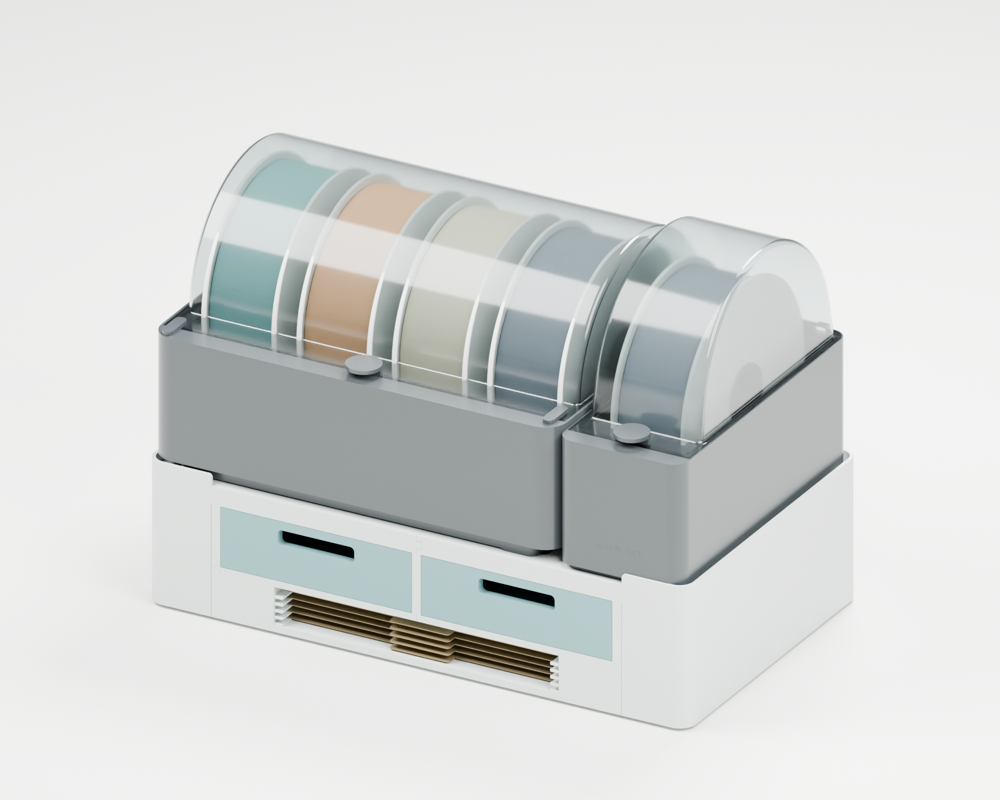](models/ams2pro+ht/) | [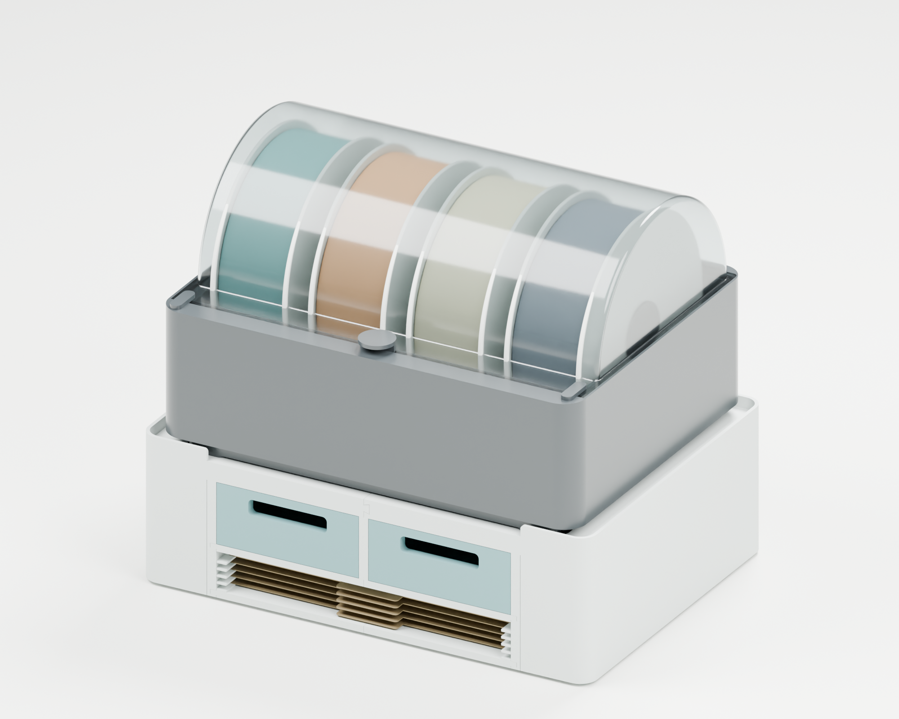](models/ams2pro/) |
| 495 × 287 mm · 单／双／三抽屉 | 399 × 287 mm · 单／双抽屉 |

两种型号均可选普通或洞洞板端框。点击图片查看对应模型。

[English](README.md) · [模型下载](models/) · [组装教程](docs/pdf/)

**打印板适配：当前所有五槽／八槽板架仅针对 256 × 256 mm 打印面积规格的拓竹板设计，适用机型为 A1、P1P、P1S、P2S、X1、X1 Carbon（X1C）、X1E 和 X2D。** 不支持 A1 mini 或 H 系列板。256 × 256 mm 是打印面积，不是钢板完整外形；第三方板需另核外形与厚度，当前模型尚未实物试装。

图片由实际底座模型渲染。设备效果图使用 Engineered Reality 的实测 STEP 模型，详见[素材说明](docs/render-assets.md)。

当前是 **数字样机**：几何检查通过；HT 版 41 种不同几何及无 HT 件均通过通用打印检查，尚未实物试装或验证承重；各层切片状态见摆盘工程索引。

[Bambu Studio 摆盘工程](print-profiles/)：提供 256 mm 和 H 系列大板方案，分别使用 X2D／P2S／H2S／H2C／H3C 的 PETG 配置；小于 256 × 256 mm 的打印板明确不支持；各工程附优化前后的切片对比；状态见索引，尚未实物验证。

[抽屉修复说明与验证](docs/drawer-repair.md)

## 无 HT 版摆放效果


五槽板层 + 双抽屉层 + 无 HT 顶件，底座尺寸 399 × 287 × 129 mm。设备使用 Engineered Reality 的原比例 CAD，[素材说明](docs/render-assets.md)。尚未实物试装或验证承重。

## 摆上 AMS 2 Pro 和 AMS HT


五槽板层 + 双抽屉层 + 顶件，底座总高 129 mm。

<details>
<summary>完整组合 · 底座总高 309 mm</summary>

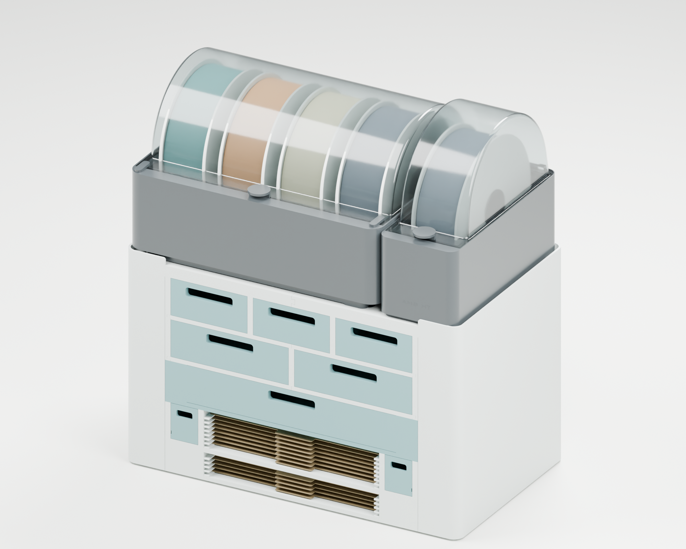

</details>

设备 CAD 作者：**Engineered Reality**（[AMS 2 Pro](https://makerworld.com/en/models/1283144-bambu-ams-2-pro-cad-model-stp-file)、[AMS HT](https://makerworld.com/en/models/1551756-bambu-ams-ht-cad-model-stp-file)）。这是渲染效果，实际落脚、通风和承重尚未验证。[素材来源与重建方法](docs/render-assets.md)。

## 模型文件

[HT 组合](models/ams2pro+ht/)包含 58 个零件；[无 HT 组合](models/ams2pro/)包含 47 个装配零件。STL、几何 3MF、各层 GLB 和完整装配 GLB 均可直接下载。两端和锁片单独放在[通用组件](models/common/)。

## 两种宽度，同一套两端

| | AMS 2 Pro + HT | 仅 AMS 2 Pro |
| --- | --- | --- |
| 占地 | 495 × 287 mm | 399 × 287 mm |
| 打印板层 | 五槽、八槽；八槽带两只侧抽屉 | 五槽、八槽；没有侧抽屉 |
| 抽屉中段 | 单、双、三抽屉 | **仅单、双抽屉，没有三抽屉** |
| 完整示例 | 15 个板位、6 只主抽屉、2 只侧抽屉；高 309 mm | 15 个板位、3 只主抽屉；高 249 mm |
| 两端 | 同高度通用 | 复用相同端框和锁片 |

无 HT 版比 HT 版窄 96 mm，仍保留 258 mm 宽打印板和每侧 1 mm 横向余量。两端各占 60 mm，中段需要容纳托架，因此底座比 372 mm 宽的 AMS 2 Pro 稍宽。顶件只有 AMS 2 Pro 区域，没有 HT 开口。

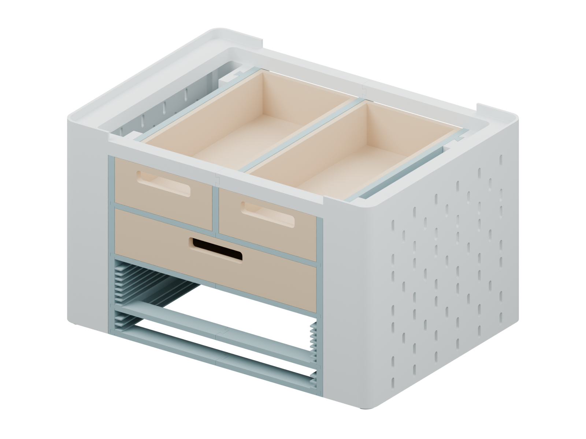

[无 HT 模型与分层组装](models/ams2pro/) · [普通端框效果](docs/images/no-ht-plain.png)

### 通用端框：普通版 / 洞洞板版

**先选端框，再选中段。** 40 mm 端框用于低板层，60 mm 端框用于八槽层及抽屉层；同高度端框可在两种宽度之间复用。扩容或换抽屉布局时不必重做两端。左右件分别使用，不能互换：右前定位槽保留原有的横向余量。

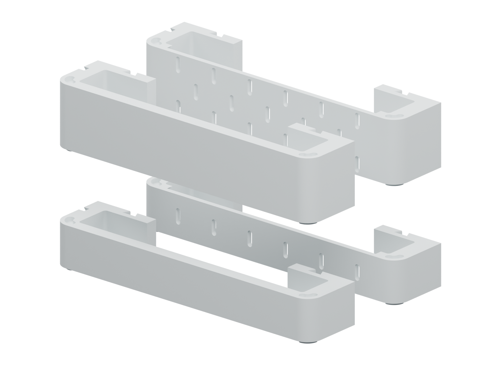

洞洞板版保持相同外廓、圆角、底脚、插槽和锁片接口，只改外侧板。孔阵居中，四角和连接区保持实心；可以只换左侧或右侧，也可以两侧都换。

- 直列竖向长圆孔：**5 × 15 mm、R2.5、板厚 5 mm**。
- 横向孔距 **40 mm**，纵向孔距 **20 mm**，每排同列对齐。
- 40 mm 端框为 **两排 12 孔**，60 mm 端框为 **三排 18 孔**；首末排孔中心距层边均为 10 mm。
- 40/60 mm 层任意换序、重复堆叠，跨缝孔中心距仍为 **20 mm**。孔后净空至少 **20 mm**；孔阵对齐不代表允许跨缝挂载。
- 先打印 [80 × 80 mm 试配板](models/common/pegboard_fit_coupon.stl)核对手头挂钩；新孔阵不承诺完整兼容 SKÅDIS，挂钩和承重仍需实测。

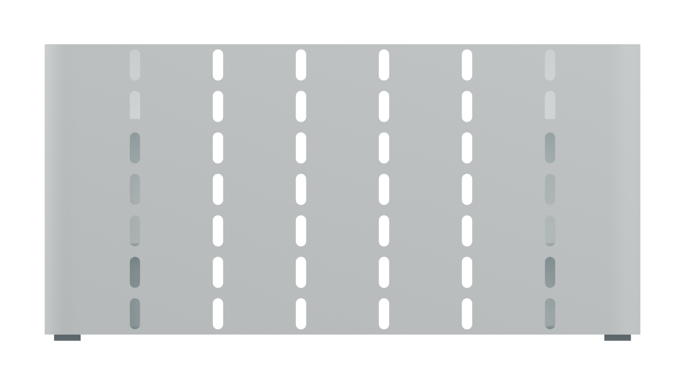

从下到上为 40 + 60 + 40 mm，接缝处保持相同孔距。

[通用件下载、孔阵规格及安装说明](models/common/) · [HT 组合的洞洞板效果](docs/images/wide-pegboard.png)

## 按需要堆叠，按整层组合（HT 版示例）

StackNest 把收纳功能放在独立层里：左右端框承接上下层，中间放打印板托架或抽屉，最上面用一套设备顶件收口。无需一次打印整套，可以先做一层，再逐层增加容量。

- **可堆叠**：各层沿用同一组弧形定位脚和插槽，竖直落座；每道层缝用左右两枚后插式锁片限制上下分离。锁片可以向后抽出，不是防丢自锁件。
- **自由组合**：五槽板层、八槽板层、单／双／三抽屉层可按整层选配、调整顺序，也可重复同一种层。设备顶件始终放在最上方，抽屉和打印板入口统一朝前。
- **逐层扩展**：需要更多打印板位就增加板层，需要更细的分类就增加双抽屉或三抽屉层。扩展时保留已有层，补打印新层和新增层缝的两枚锁片即可；当前五槽层文件未包含层间锁片，用在上层时需另取通用锁片。最底层不安装下接缝锁片。
- **可拆换、可维修**：端框、中段承架、横梁、抽屉和顶件分件制作。更换模块时先移走设备和上层，再拆锁片、提开层体。不同抽屉布局应整层更换，单抽屉不能直接塞进双抽屉的导向结构。

40 mm 和 60 mm 是层体的高度增量，不是总成外廓。带顶件的底座总高为 **所选层高之和 + 29 mm**（顶件 26 mm、底脚 3 mm），不含 AMS 设备。HT 版宽深为 495 × 287 mm；无 HT 版为 399 × 287 mm。

| 组合示例（从下到上） | 收纳能力 | 底座总高 |
| --- | --- | ---: |
| 五槽板层 → 顶件 | 5 个板位 | 69 mm |
| 五槽板层 → 双抽屉层 → 顶件 | 5 个板位、2 只主抽屉 | 129 mm |
| 八槽板层 × 2 → 三抽屉层 → 顶件 | 16 个板位、3 只主抽屉、4 只侧抽屉 | 209 mm |
| 单抽屉层 → 双抽屉层 → 三抽屉层 → 顶件 | 6 只主抽屉 | 209 mm |
| 本页完整组合 A → B → C → D → E → F | 15 个板位、6 只主抽屉、2 只侧抽屉 | 309 mm |

下面是 HT 组合的层间关系。

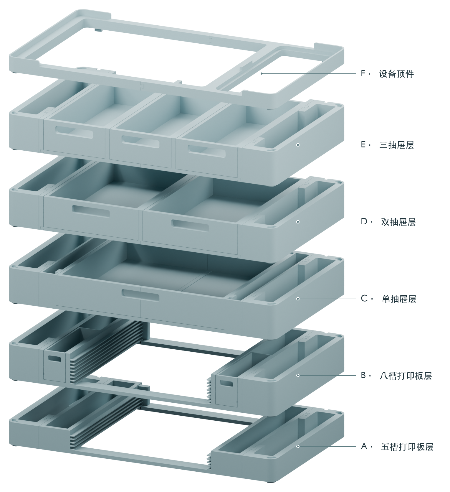

图中从上到下依次为（点击层名下载模型）：

| 层 | 名称 | 用途 |
| --- | --- | --- |
| F | [设备顶件](models/ams2pro+ht/06-device-top/) | 承放 AMS 2 Pro + AMS HT |
| E | [三抽屉层](models/ams2pro+ht/05-triple-drawer-layer/) | 三只独立抽屉，分类放小配件 |
| D | [双抽屉层](models/ams2pro+ht/04-double-drawer-layer/) | 两只独立抽屉，分开收纳工具与备件 |
| C | [单抽屉层](models/ams2pro+ht/03-single-drawer-layer/) | 一只宽抽屉，收纳较长工具 |
| B | [八槽打印板层](models/ams2pro+ht/02-eight-slot-plate-layer/) | 收纳 8 张打印板，两侧各一只小抽屉 |
| A | [五槽打印板层](models/ams2pro+ht/01-five-slot-plate-layer/) | 收纳 5 张常用打印板 |

这是完整组合示例，收纳层可按需选配，无需全部打印；顶件始终放在最上层。

接口可复用不代表能够无限加高。当前没有额定承重或最大层数；组合改变后需重新检查稳定性、设备净空与实际配合。两种宽度各自成套堆叠，不能把 399 mm 和 495 mm 的整层上下混搭；两端和锁片可复用，中段和顶件需匹配宽度。

## HT 版每一层怎么用

### A · 40 mm 五槽打印板层

40 mm 层高容纳 5 张板：槽距 6 mm，按板厚最大 1.5 mm 预留，顶槽上方保留 7 mm 净空。沿用这组间距时，第 6 槽至少需要 46 mm 层高。旧 30 mm 三槽版已移除，升级时需一起更换低层端框和承架。

低矮的入门板层，适合常用的五张打印板。左右托条支撑板边，一直延伸到后挡；两侧前封闭面和承架做成一体，没有额外封板。由两只端框、两只承架及前后横梁组成，共 6 件。板从正面放入，取出时先抬约 1 mm，再向前抽出。

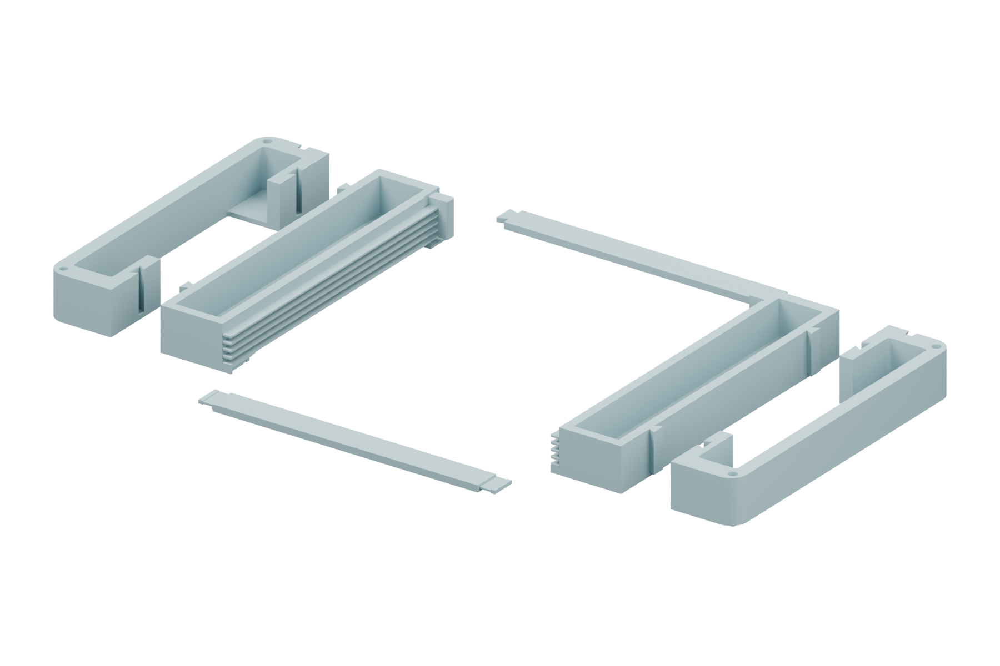

[模型与零件](models/ams2pro+ht/01-five-slot-plate-layer/) · [组装教程](docs/pdf/01-five-slot-plate-layer-assembly-zh.pdf)

### B · 60 mm 八槽打印板层

在同样的占地内提供八个板位，两侧另有两只小抽屉，可放小工具和零件。托条和刚性后挡负责定位，后挡不是弹性卡扣。侧抽屉行程约 60 mm；拆卸需先移走上层，再在止点抬高约 12 mm。共 10 件，包含本层下方接缝的两枚锁片。

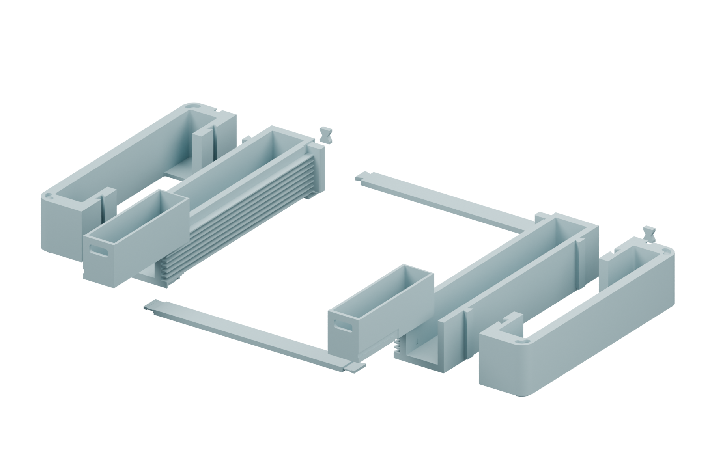

[模型与零件](models/ams2pro+ht/02-eight-slot-plate-layer/) · [组装教程](docs/pdf/02-eight-slot-plate-layer-assembly-zh.pdf)

### C · 60 mm 单抽屉层

宽抽屉适合较长工具或不便分格的物品。抽屉分为左右两半：左半从右半后方沿纵向燕尾向前滑合。底板为 2 mm 实心板，接缝加厚筋在内侧凸起 0.8 mm。旧前后两半需成对替换，不能和新版混用。先拼抽屉，再装承架与横梁，最后沿导向放入。主抽屉行程约 180 mm，在止点抬高约 7 mm 后才能取出。共 10 件，包含两枚层间锁片。

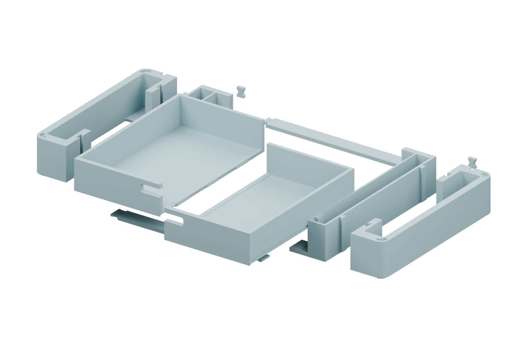

[模型与零件](models/ams2pro+ht/03-single-drawer-layer/) · [组装教程](docs/pdf/03-single-drawer-layer-assembly-zh.pdf)

### D · 60 mm 双抽屉层

两只独立抽屉配一片中间隔墙，适合把工具和备件分开。前后横梁各由两片拼合，隔墙定位舌从上方落入横梁槽。每只抽屉是一体零件，采用 2 mm 实心底板；两侧各自导向、限位，行程约 180 mm。共 13 件，包含两枚层间锁片。

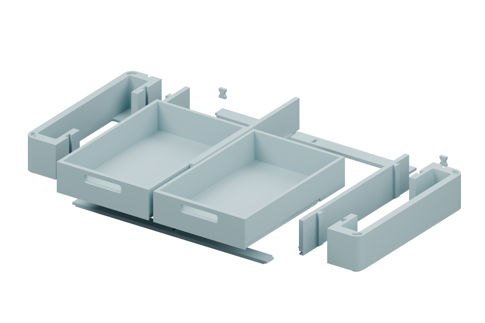

[模型与零件](models/ams2pro+ht/04-double-drawer-layer/) · [组装教程](docs/pdf/04-double-drawer-layer-assembly-zh.pdf)

### E · 60 mm 三抽屉层

三只窄抽屉配两片隔墙，适合分类存放喷嘴、小五金或耗材配件。三只抽屉独立抽拉，底板同为 2 mm 实心板；装配时先确认两片隔墙的前后定位舌都进入槽内，再逐只试滑。共 15 件，包含两枚层间锁片。双／三抽屉层和单抽屉层使用相同的层高与上下接口。

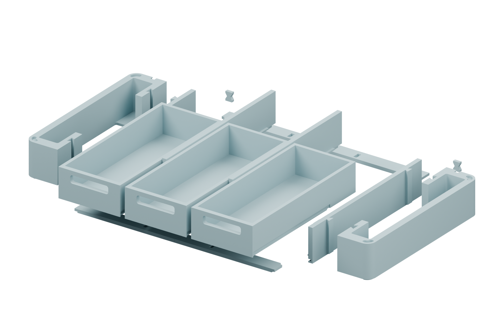

[模型与零件](models/ams2pro+ht/05-triple-drawer-layer/) · [组装教程](docs/pdf/05-triple-drawer-layer-assembly-zh.pdf)

### F · AMS 2 Pro + AMS HT 设备顶件

顶件由左右两片和两枚后锁片组成，共 4 件。两片保持同高，通过前后两处燕尾滑合，再将四个弧形底脚落入最上层插槽。左侧是 AMS 2 Pro 的摆放区域，右侧为 AMS HT 的阶梯开口；外缘局部凸边用于定位。它可随收纳层数量移动到新的顶部，不需要每次扩容都重做顶件。

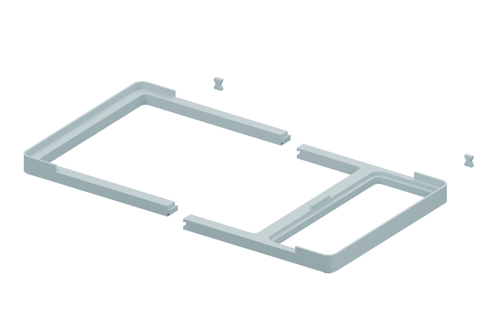

[模型与零件](models/ams2pro+ht/06-device-top/) · [组装教程](docs/pdf/06-device-top-assembly-zh.pdf)

设备上架前仍须核对实际脚位、底壳、进气口、管线与开盖空间。顶件外观与效果图不能代替实物适配检查。

## 从源码生成

安装 Python 3.12+ 和 uv，然后运行：

```sh
uv sync --frozen
uv run python tools/build.py
uv run python tools/verify.py
uv run python tools/verify_drawer_repair.py
cad run tools/check_printing.py
uv run python tools/package.py
# 无 HT 与通用洞洞板端框
cad run tools/build_variants.py
uv run python tools/verify_variants.py
uv run python tools/check_variants.py
uv run python tools/bundle.py
uv run python tools/check_bundles.py
```

模型由参数和基本几何生成，不读取旧版网格或第三方模型文件。STL 单位为毫米；3MF 只有装配几何，不含打印配置，不能直接发送打印。

无 HT 版通过 1081 对总装、1739 对层间组合检查及 36 件新增导出件的 PETG/FDM 检查；仍有支撑、桥接和尖边提示，对应 X2D/PETG 摆盘工程已逐盘切片，尚未实物试装。HT 版也已同步更新 40 mm 五槽层和顶件 R3 圆角。原 HT 版检查涵盖 1653 对装配关系和主要运动路径。41 种不同几何全部通过 PETG/FDM 通用规则检查；单抽屉拼接槽加厚，抽屉方向与支撑以对应机型工程为准，仍有悬垂、桥接和薄尖边提示。`verify_drawer_repair.py` 检查接缝余料、滑合限位、实心底板和平面着床。未给出额定承重，设备脚位、底壳、通风和走线需要实际确认。

更多构建、渲染与验证方法见 [English README](README.md)。设计基础见 [provenance](docs/provenance.md)。

从社区已有模型的实践为参考设计基础。所有抽屉采用2 mm实心底板，单抽屉改用加厚的左右拼接，滑轨接口保留。

## 许可

版权所有 © 2026 [overtrue](https://github.com/overtrue)。本仓库中的 StackNest 模型、参数化源码、工具链与文档采用 [知识共享 署名-非商业性使用 4.0 国际 (CC BY-NC 4.0)](https://creativecommons.org/licenses/by-nc/4.0/deed.zh) 许可。

您可以为**个人用途**自行 3D 打印、修改并在注明出处的前提下分享这些模型。**禁止商业销售及其他商业用途。** 仅用于渲染的第三方设备 CAD 不在许可范围内，见[素材说明](docs/render-assets.md)。完整法律文本见 [LICENSE](LICENSE)。
