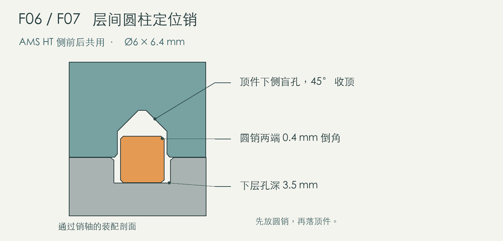

# 256 mm · X2D / P2S

这套拆件覆盖 399 mm 无 HT 和 495 mm 带 HT 的各五种主层。X2D、P2S 分别导入对应机型的 Bambu Studio 工程。用 Bambu PETG Matte 时选文件名含 `petg-matte` 的版本。无 HT 版提供单、双抽屉，带 HT 版提供双、三抽屉。

## 先试 F06 前角

`fit-check/front-pin` 只有三件。把 P3 短圆销放进 P1 下层圆孔，任一端朝下，再放上 P2 顶件。试过后掉头再装一次。X2D 的 Matte 试件为 10.98 g、约 34 分钟。支撑约 0.05 g，全部位于下框外缘的前 1.8 mm 打印高度。顶件、销和两个配合孔均无支撑路径。

F06、F07 共用 Ø6 × 6.4 mm，两端各倒角 0.4 mm。普通层的四个圆销直接长在端框底面。HT 侧沿用两枚可取下的定位销，先放销再落座。每道层缝两侧各用一片通用蝴蝶锁片，从后方水平推入。保留已打印的一体弧脚 HT 右顶件时，用与下层高度对应的右过渡端框。旧版右顶件已在 40 和 60 mm 两个过渡框上检查过竖直装入路径。

两种宽度、两种端框及 HT 过渡框都可用同一文件补打尾锁。 / Both widths, both end styles and the HT transition ends take the same spare. [通用锁片 STL / Rear key STL](../models/common/rear-lock.stl)

## 各层怎么拼

- 同一编号的 a 是前段、b 是后段。先将两个截面对齐，从上面合拢燕尾，再将整件装入底座。接缝按徒手下插设计，无需螺丝或胶。
- 五槽、八槽板托分别拆为前后两段，从各自的外端面开始打印。装配后检查每条托槽的接缝齐平，再插入打印板。
- 双、三抽屉分成前后两半，两处侧壁燕尾和底板上的宽舌一次合拢。上下各 0.9 mm 的底板搭边相叠，中间预留 0.2 mm。抽屉止挡、导槽和 180 mm 行程沿用原尺寸。
- 单抽屉保留已有的前后两半。399 mm 各层的前、后横梁分别做成一整根 J，平放对角打印，装配时少拼两处。已经能稳定整件打印的侧轨、侧盒也保留整件。
- 设备顶件左侧 F01 及无 HT 两侧均分成前后段。a/b 合拢后再滑合左右顶片。HT 右侧 F02、F05 底面贴板，圆销 F06、F07 通用。

The 256 mm parts are marked in each layer guide and Bambu plate. Lower matching front (a) and rear (b) dovetails together before fitting the completed part. Drawer-wall tails and overlapping floor tongues engage in one motion. J identifies a one-piece flat beam. The ten layer folders contain an exploded preview, an interactive assembled GLB and the cutting list. [Layers and part IDs](../models/256/README.md)

## 实际整层切片

Basic 的前后数据来自同一机型、0.4 mm 喷嘴、0.20 mm 层高、四道墙、20% 填充和 3 mm 外裙边。时间逐盘相加，含切片器计入的准备时间。Matte 独立使用机型对应的官方 GFG03 预设，支撑包括接触层，按 1.75 mm 丝径和该预设的 1.37 g/cm³ 换算。整层对照中的 Basic 使用 1.25 g/cm³。

| 机型 | 设备 | 层 | 盘数 | Basic 时间 h | Basic 总耗材 g | Basic 支撑 g | Matte 时间 h | Matte 总耗材 g | Matte 支撑 g |
| --- | --- | --- | ---: | ---: | ---: | ---: | ---: | ---: | ---: |
| X2D | 399 | 单抽屉 | 6 → 4 | 31.4 → 29.8 | 1057.5 → 1052.9 | 30.3 → 15.8 | 31.6 | 1154.0 | 17.3 |
| X2D | 399 | 双抽屉 | 7 → 3 | 49.6 → 35.7 | 1393.0 → 1255.2 | 215.1 → 16.7 | 37.9 | 1375.8 | 18.3 |
| X2D | 399 | 五槽 | 4 → 1 | 21.7 → 17.1 | 540.1 → 542.3 | 60.7 → 13.0 | 17.9 | 594.3 | 14.2 |
| X2D | 399 | 八槽 | 5 → 2 | 29.1 → 23.4 | 755.3 → 753.9 | 79.5 → 17.1 | 24.5 | 826.3 | 18.8 |
| X2D | 399 | 设备顶件 | 2 → 1 | 11.5 → 8.5 | 269.2 → 268.9 | 1.6 → 0.7 | 8.9 | 294.7 | 0.7 |
| X2D | 495 + HT | 五槽 | 5 → 2 | 33.3 → 24.4 | 832.5 → 800.3 | 117.3 → 14.9 | 25.7 | 877.2 | 16.4 |
| X2D | 495 + HT | 八槽 | 6 → 2 | 48.6 → 35.0 | 1255.8 → 1208.5 | 172.8 → 21.3 | 37.1 | 1324.5 | 23.3 |
| X2D | 495 + HT | 双抽屉 | 8 → 3 | 53.8 → 38.3 | 1565.4 → 1364.7 | 262.5 → 16.1 | 40.7 | 1495.7 | 17.6 |
| X2D | 495 + HT | 三抽屉 | 10 → 3 | 63.4 → 44.8 | 1737.4 → 1591.7 | 280.1 → 17.8 | 47.6 | 1744.5 | 19.5 |
| X2D | 495 + HT | 设备顶件 | 3 → 3 | 11.4 → 10.0 | 295.1 → 290.2 | 1.4 → 0.9 | 10.3 | 318.1 | 1.0 |
| P2S | 399 | 单抽屉 | 6 → 4 | 31.3 → 29.7 | 1057.5 → 1052.9 | 30.3 → 15.8 | 31.4 | 1154.0 | 17.3 |
| P2S | 399 | 双抽屉 | 7 → 3 | 49.6 → 35.6 | 1393.0 → 1255.2 | 215.1 → 16.7 | 37.5 | 1375.8 | 18.3 |
| P2S | 399 | 五槽 | 4 → 1 | 21.0 → 16.9 | 540.1 → 542.3 | 60.7 → 13.0 | 17.7 | 594.3 | 14.2 |
| P2S | 399 | 八槽 | 5 → 2 | 28.6 → 23.3 | 755.3 → 753.9 | 79.5 → 17.1 | 24.2 | 826.3 | 18.8 |
| P2S | 399 | 设备顶件 | 2 → 1 | 11.4 → 8.5 | 269.2 → 268.9 | 1.6 → 0.7 | 8.8 | 294.7 | 0.7 |
| P2S | 495 + HT | 五槽 | 5 → 2 | 32.9 → 24.3 | 832.5 → 800.3 | 117.3 → 14.9 | 25.4 | 877.2 | 16.4 |
| P2S | 495 + HT | 八槽 | 6 → 2 | 48.1 → 34.9 | 1255.8 → 1208.5 | 172.8 → 21.3 | 36.6 | 1324.5 | 23.3 |
| P2S | 495 + HT | 双抽屉 | 8 → 3 | 53.9 → 38.2 | 1565.4 → 1364.7 | 262.5 → 16.1 | 40.4 | 1495.7 | 17.6 |
| P2S | 495 + HT | 三抽屉 | 10 → 3 | 63.6 → 44.7 | 1737.4 → 1591.7 | 280.1 → 17.8 | 47.2 | 1744.5 | 19.5 |
| P2S | 495 + HT | 设备顶件 | 3 → 3 | 11.3 → 10.0 | 295.1 → 290.2 | 1.4 → 0.9 | 10.2 | 318.1 | 1.0 |

每行是一套完整层工程，含随层提供的锁片。两种宽度分别使用，按需要打印选定的层。Matte 和 Basic 均未进行新版实物承重或配合试验。

## 选型和摆向依据

常见直销、插接和燕尾用于不同的装配动作。这里四角采用圆柱来定位，接缝采用燕尾约束侧向移动。相同的三件角部试样在 X2D Matte 下，原弧脚 25.12 g / 54 分钟，方销 23.31 g / 51 分钟，圆销 23.16 g / 51 分钟，均为零支撑。方销转 45° 会干涉，圆销 0–355° 每 5° 取样均可落座。[Prusa 切割与连接件](https://help.prusa3d.com/article/cut-tool_1779) · [Prusa 打印方向设计](https://help.prusa3d.com/article/modeling-with-3d-printing-in-mind_164135)

五槽 A03 和八槽 B05 共用的前横梁带一只可按动的卡舌。底面朝下时，树状支撑进入卡舌上方的 0.6 mm 间隙。将顶面贴板后保留 5,856 mm² 着床面积，槽内无支撑。单件 X2D Basic 对比为 45.1 分钟、23.97 g；窄边摆放为 50.0 分钟、30.44 g。

中间隔板双面都带导轨。两半侧躺试切需 4.70 h、21.50 g 支撑，且只有凸出的导轨着床。改从前后端面对印后，两半各有 432 mm² 首层接触，用 3.46 h、0.50 g 支撑。整根薄横梁仍以大面平放。

同一 X2D Basic 预设的独立试切中，带 HT 的一只双抽屉原来需要约 112.8 g 支撑。前、后段各自以外端面着床的试样为零支撑，两半首层接触分别约 8,300 和 8,900 mm²。八槽宽托架从原来的 74.1 g 支撑降到 5.5 g；两段同向摆放为 31.6 g。完整层采用独立的前后摆向。左右件分别验证尺寸、落位、裙边、支撑间距和实际喷头范围。

60 mm 普通端框以外侧大面整打需 7.28 h / 16.4 g 支撑；前后拆开、外端面分别着床为 6.71 h / 4.55 g。洞洞板的结果相反：左右整件各自大面朝下，保留孔壁和整片侧板，整对 2 盘 13.55 h / 332.4 g；分成四件从前后端打虽然能合成 1 盘，却需要 14.23 h / 402.2 g。因此普通端框拆开，洞洞板保留整件。

实物反馈来自旧版 HT 侧；上表是 Bambu Studio 的 G-code 估算。材料批次、热收缩、设备实际净空与负载仍需实测。
