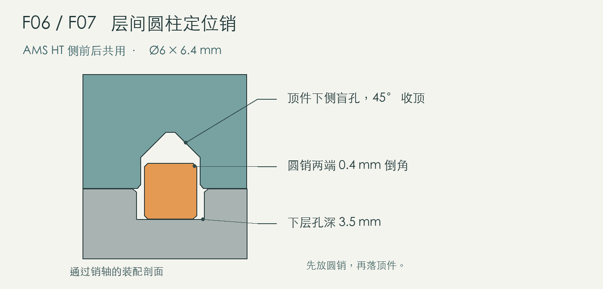

# AMS HT 顶件右侧 / HT-side device top

F06 是顶件右前角的竖直定位销，在装配 GLB 中对应 n5。F07 在右后角。两只都是 Ø6 × 6.4 mm 圆柱，两端各有 0.4 mm 倒角，可以互换或掉头。先把它们放入下层两个圆孔，再放上顶件。下层孔深 3.5 mm，圆销落到底后仍伸出 2.9 mm。顶件下侧的盲孔用 45° 斜面收顶，顶面连续。承重面是端框和顶件的平面。

F06 and F07 are identical vertical dowels at the right front and rear corners. Place either end in the lower frame and lower the top onto them. F03 and F04 are two copies of the common rear bowtie. Either key slides into either rear slot, either end up. The front locator, upper socket and lower socket can be tried together using the three-piece 256 mm project `fit-check/front-pin`.

## 已经打印了旧右侧 / Using an existing HT-side print

- 原版右顶件底下带一体弧脚。如果上层继续用这件、下方采用新圆孔系列，请选与下层同高的 `compatibility/ht-right-40` 或 `ht-right-60`，拼成一个右端框。它上面收旧弧脚、下面带新圆销。已经成对使用的旧上下件可继续搭配。
- 原一体右顶件的尾槽可以直接装通用蝴蝶锁片。如果你已打印分体版，且 F05 只配尖头锁片，换新版 F05 和一片通用锁片即可。F02 前段和两枚圆销可继续用。
- 换新右侧时打印 F02、F04、F05、F06、F07。F02 前段和 F05 后段底面贴板，沿两处燕尾竖直合拢。装入下层圆销后落座，最后从后面水平推入通用蝴蝶锁片。F03、F04 左右通用，上下翻转均可。旧下层弧槽也能容纳新圆销。旧的带头弧脚和对应通孔顶件应成对使用。
- The original one-piece top accepts the common bowtie. If your split F05 takes the pointed key, replace F05 and use a common bowtie. Keep the front F02 and both round dowels.
- To keep the original HT-side upper part with integral curved feet, use the height-matched 40 or 60 mm right transition end on the new stack. To replace that upper part, print the five-piece right-side project. The round pins fit both the new round receivers and the previous curved receivers. Keep a previously printed left top with its matching receiver if it has an older curved foot.

## 先试前角 / Front-corner trial

从 X2D 或 P2S 的 `fit-check/front-pin` 打开 PETG Matte 工程。P1 是右下端框顶角，P2 是 F02 的前角，P3 就是 F06。按生产方向打印，翻转 P3 再装一次，检查四角落座时应接触的平面及 R15 外圆角。需要一并检查后锁片和前后段燕尾时，用 `fit-check/ht-top`。

在 X2D、P2S 的 Basic 和 Matte 切片中，前角试件与整层 F02 的 R15 外轮廓都检查了 130 层，每层沿圆弧取 89 个点。每层均有外壁挤出路径。前角试件的支撑只出现在 P1 的头 1.8 mm 打印高度。

Three otherwise matched X2D PETG Matte corner trials compared the former curved foot, a square dowel and a round dowel. The round dowel seated at every rotation tested. The square dowel interfered at 45°. The cropped equal-condition tests below were bottom-down. P1 in the separate front test uses the production front-end orientation. [PrusaSlicer connector types](https://help.prusa3d.com/article/cut-tool_1779) · [Prusa FDM design and orientation guide](https://help.prusa3d.com/article/modeling-with-3d-printing-in-mind_164135)

| X2D · PETG Matte · 角部三件 / Three corner pieces | 时间 | 总耗材 | 支撑 |
| --- | ---: | ---: | ---: |
| 原弧脚 / Curved foot | 54 min | 25.12 g | 0 g |
| 方销 / Square | 51 min | 23.31 g | 0 g |
| 圆销 / Round | 51 min | 23.16 g | 0 g |

原 HT 右侧已有 PETG Matte 实打反馈。新圆销的配合手感、圆角外观及整架承重仍待实物确认。 / The original HT-side part was printed in matte PETG. The revised fit, corner finish and load capacity still need a physical test.
