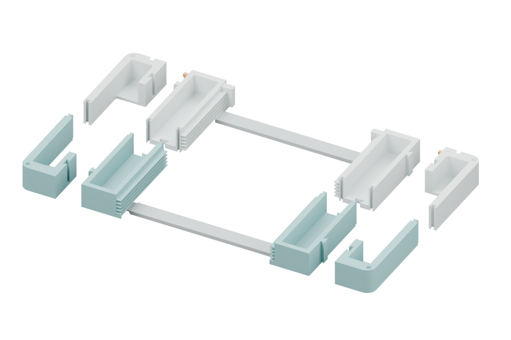

# ams2pro-ht/01-five-slot-plate-layer · 256 mm

先将同编号的前段 a 与后段 b 错开高度，对准燕尾后竖直合拢。图中前段为青色，后段为浅灰色。J 是整根横梁。

Match the number, align the front (a) and rear (b) tails, then lower one section into the other. Front sections are teal and rear sections light grey. J identifies a one-piece beam.

[装配模型 / Assembly](layer-assembly.glb)

| 打印编号 / Print ID | 装配编号 / Assembly ID | STL |
| --- | --- | --- |
| A01a | A01 | [A01a.stl](A01a.stl) |
| A01b | A01 | [A01b.stl](A01b.stl) |
| A02a | A02 | [A02a.stl](A02a.stl) |
| A02b | A02 | [A02b.stl](A02b.stl) |
| A03 | A03 | [A03-low_0_cassette_plates_3.stl](../../../ams2pro+ht/01-five-slot-plate-layer/parts/A03-low_0_cassette_plates_3.stl) |
| A04 | A04 | [A04-low_0_cassette_plates_4.stl](../../../ams2pro+ht/01-five-slot-plate-layer/parts/A04-low_0_cassette_plates_4.stl) |
| A05a | A05 | [A05a.stl](A05a.stl) |
| A05b | A05 | [A05b.stl](A05b.stl) |
| A06a | A06 | [A06a.stl](A06a.stl) |
| A06b | A06 | [A06b.stl](A06b.stl) |
| KEY-left | KEY-left | [rear-lock.stl](../../../common/rear-lock.stl) |
| KEY-right | KEY-right | [rear-lock.stl](../../../common/rear-lock.stl) |
