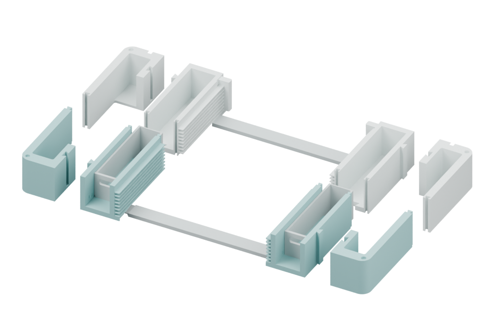

# ams2pro-ht/02-eight-slot-plate-layer · 256 mm

先将同编号的前段 a 与后段 b 错开高度，对准燕尾后竖直合拢。图中前段为青色，后段为浅灰色。J 是整根横梁。

Match the number, align the front (a) and rear (b) tails, then lower one section into the other. Front sections are teal and rear sections light grey. J identifies a one-piece beam.

[装配模型 / Assembly](layer-assembly.glb)

| 打印编号 / Print ID | 装配编号 / Assembly ID | STL |
| --- | --- | --- |
| B01 | B01 | [rear-lock.stl](../../../common/rear-lock.stl) |
| B02 | B02 | [rear-lock.stl](../../../common/rear-lock.stl) |
| B03a | B03 | [B03a.stl](B03a.stl) |
| B03b | B03 | [B03b.stl](B03b.stl) |
| B04a | B04 | [B04a.stl](B04a.stl) |
| B04b | B04 | [B04b.stl](B04b.stl) |
| B05 | B05 | [B05-standard_1_cassette_plates_3.stl](../../../ams2pro+ht/02-eight-slot-plate-layer/parts/B05-standard_1_cassette_plates_3.stl) |
| B06 | B06 | [B06-standard_1_cassette_plates_4.stl](../../../ams2pro+ht/02-eight-slot-plate-layer/parts/B06-standard_1_cassette_plates_4.stl) |
| B07a | B07 | [B07a.stl](B07a.stl) |
| B07b | B07 | [B07b.stl](B07b.stl) |
| B08a | B08 | [B08a.stl](B08a.stl) |
| B08b | B08 | [B08b.stl](B08b.stl) |
| B09 | B09 | [B09-standard_1_side_bin_left_1.stl](../../../ams2pro+ht/02-eight-slot-plate-layer/parts/B09-standard_1_side_bin_left_1.stl) |
| B10 | B10 | [B10-standard_1_side_bin_right_1.stl](../../../ams2pro+ht/02-eight-slot-plate-layer/parts/B10-standard_1_side_bin_right_1.stl) |
