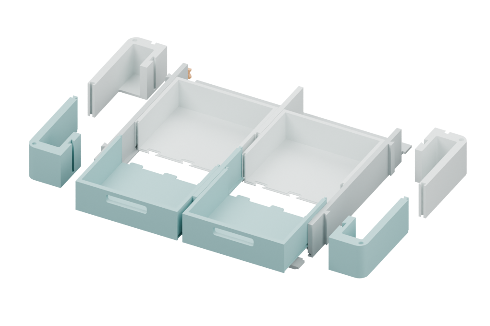

# ams2pro-ht/04-double-drawer-layer · 256 mm

先将同编号的前段 a 与后段 b 错开高度，对准燕尾后竖直合拢。图中前段为青色，后段为浅灰色。J 是整根横梁。

Match the number, align the front (a) and rear (b) tails, then lower one section into the other. Front sections are teal and rear sections light grey. J identifies a one-piece beam.

[装配模型 / Assembly](layer-assembly.glb)

| 打印编号 / Print ID | 装配编号 / Assembly ID | STL |
| --- | --- | --- |
| D01a | D01 | [D01a.stl](D01a.stl) |
| D01b | D01 | [D01b.stl](D01b.stl) |
| D02a | D02 | [D02a.stl](D02a.stl) |
| D02b | D02 | [D02b.stl](D02b.stl) |
| D03a | D03 | [D03a.stl](D03a.stl) |
| D03b | D03 | [D03b.stl](D03b.stl) |
| D04a | D04 | [D04a.stl](D04a.stl) |
| D04b | D04 | [D04b.stl](D04b.stl) |
| D05a | D05 | [D05a.stl](D05a.stl) |
| D05b | D05 | [D05b.stl](D05b.stl) |
| D06 | D06 | [D06-2drawers_front_beam_1.stl](../../../ams2pro+ht/04-double-drawer-layer/parts/D06-2drawers_front_beam_1.stl) |
| D07 | D07 | [D07-2drawers_front_beam_2.stl](../../../ams2pro+ht/04-double-drawer-layer/parts/D07-2drawers_front_beam_2.stl) |
| D08 | D08 | [D08-2drawers_rear_beam_1.stl](../../../ams2pro+ht/04-double-drawer-layer/parts/D08-2drawers_rear_beam_1.stl) |
| D09 | D09 | [D09-2drawers_rear_beam_2.stl](../../../ams2pro+ht/04-double-drawer-layer/parts/D09-2drawers_rear_beam_2.stl) |
| D10 | D10 | [rear-lock.stl](../../../common/rear-lock.stl) |
| D11 | D11 | [rear-lock.stl](../../../common/rear-lock.stl) |
| D12 | D12 | [D12-2drawers_side_left.stl](../../../ams2pro+ht/04-double-drawer-layer/parts/D12-2drawers_side_left.stl) |
| D13 | D13 | [D13-2drawers_side_right.stl](../../../ams2pro+ht/04-double-drawer-layer/parts/D13-2drawers_side_right.stl) |
