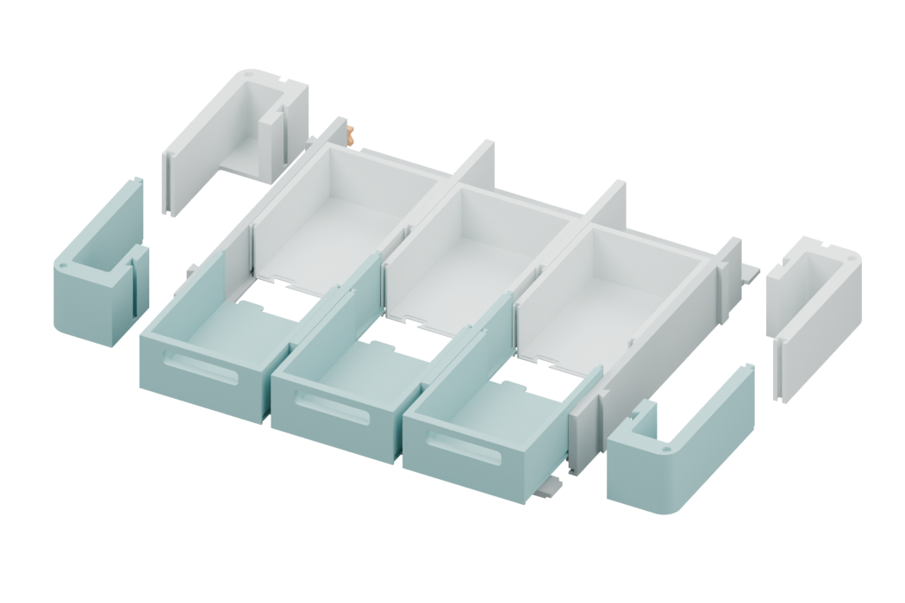

# ams2pro-ht/05-triple-drawer-layer · 256 mm

先将同编号的前段 a 与后段 b 错开高度，对准燕尾后竖直合拢。图中前段为青色，后段为浅灰色。J 是整根横梁。

Match the number, align the front (a) and rear (b) tails, then lower one section into the other. Front sections are teal and rear sections light grey. J identifies a one-piece beam.

[装配模型 / Assembly](layer-assembly.glb)

| 打印编号 / Print ID | 装配编号 / Assembly ID | STL |
| --- | --- | --- |
| E01a | E01 | [E01a.stl](E01a.stl) |
| E01b | E01 | [E01b.stl](E01b.stl) |
| E02a | E02 | [E02a.stl](E02a.stl) |
| E02b | E02 | [E02b.stl](E02b.stl) |
| E03a | E03 | [E03a.stl](E03a.stl) |
| E03b | E03 | [E03b.stl](E03b.stl) |
| E04a | E04 | [E04a.stl](E04a.stl) |
| E04b | E04 | [E04b.stl](E04b.stl) |
| E05a | E05 | [E05a.stl](E05a.stl) |
| E05b | E05 | [E05b.stl](E05b.stl) |
| E06a | E06 | [E06a.stl](E06a.stl) |
| E06b | E06 | [E06b.stl](E06b.stl) |
| E07a | E07 | [E07a.stl](E07a.stl) |
| E07b | E07 | [E07b.stl](E07b.stl) |
| E08 | E08 | [E08-3drawers_front_beam_1.stl](../../../ams2pro+ht/05-triple-drawer-layer/parts/E08-3drawers_front_beam_1.stl) |
| E09 | E09 | [E09-3drawers_front_beam_2.stl](../../../ams2pro+ht/05-triple-drawer-layer/parts/E09-3drawers_front_beam_2.stl) |
| E10 | E10 | [E10-3drawers_rear_beam_1.stl](../../../ams2pro+ht/05-triple-drawer-layer/parts/E10-3drawers_rear_beam_1.stl) |
| E11 | E11 | [E11-3drawers_rear_beam_2.stl](../../../ams2pro+ht/05-triple-drawer-layer/parts/E11-3drawers_rear_beam_2.stl) |
| E12 | E12 | [rear-lock.stl](../../../common/rear-lock.stl) |
| E13 | E13 | [rear-lock.stl](../../../common/rear-lock.stl) |
| E14 | E14 | [E14-3drawers_side_left.stl](../../../ams2pro+ht/05-triple-drawer-layer/parts/E14-3drawers_side_left.stl) |
| E15 | E15 | [E15-3drawers_side_right.stl](../../../ams2pro+ht/05-triple-drawer-layer/parts/E15-3drawers_side_right.stl) |
