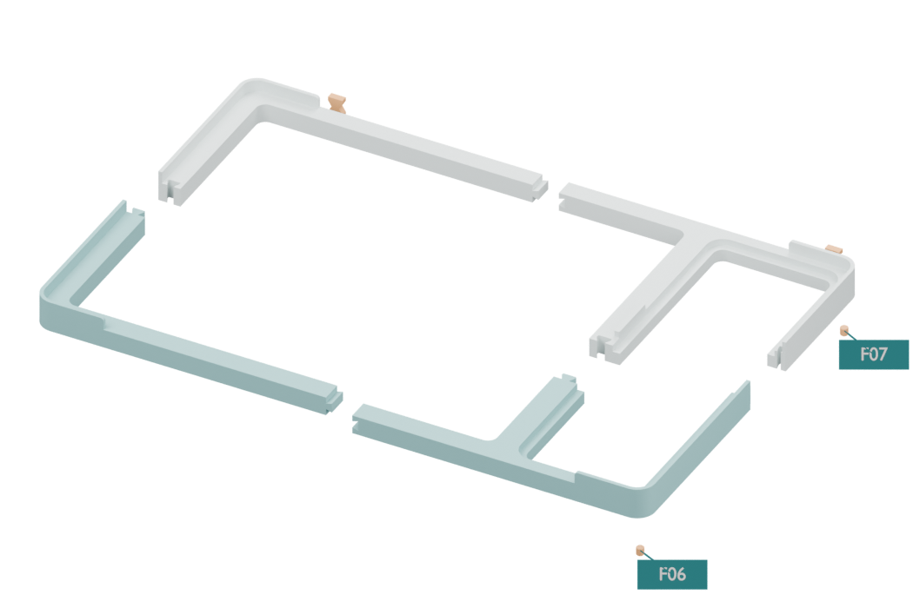

# ams2pro-ht/06-device-top · 256 mm

先将同编号的前段 a 与后段 b 错开高度，对准燕尾后竖直合拢。图中前段为青色，后段为浅灰色。J 是整根横梁。

Match the number, align the front (a) and rear (b) tails, then lower one section into the other. Front sections are teal and rear sections light grey. J identifies a one-piece beam.

[装配模型 / Assembly](layer-assembly.glb)

| 打印编号 / Print ID | 装配编号 / Assembly ID | STL |
| --- | --- | --- |
| F01a | F01 | [F01a.stl](F01a.stl) |
| F01b | F01 | [F01b.stl](F01b.stl) |
| F02 | F02 | [F02-device_adapter_2.stl](../../../ams2pro+ht/06-device-top/parts/F02-device_adapter_2.stl) |
| F03 | F03 | [rear-lock.stl](../../../common/rear-lock.stl) |
| F04 | F04 | [rear-lock.stl](../../../common/rear-lock.stl) |
| F05 | F05 | [F05-ht_top_rear.stl](../../../ams2pro+ht/06-device-top/parts/F05-ht_top_rear.stl) |
| F06 | F06 | [F06-ht_foot_front.stl](../../../ams2pro+ht/06-device-top/parts/F06-ht_foot_front.stl) |
| F07 | F07 | [F07-ht_foot_rear.stl](../../../ams2pro+ht/06-device-top/parts/F07-ht_foot_rear.stl) |
