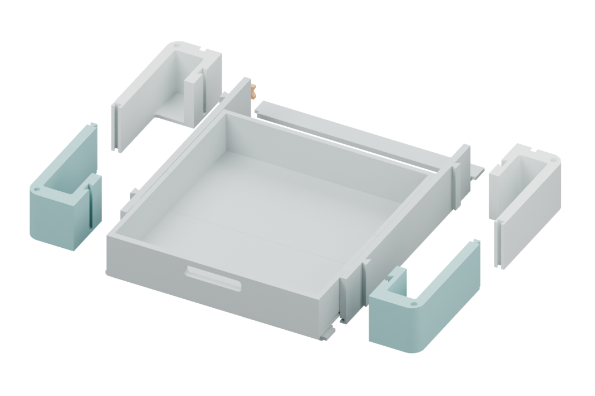

# ams2pro/1-drawer-layer · 256 mm

先将同编号的前段 a 与后段 b 错开高度，对准燕尾后竖直合拢。图中前段为青色，后段为浅灰色。J 是整根横梁。

Match the number, align the front (a) and rear (b) tails, then lower one section into the other. Front sections are teal and rear sections light grey. J identifies a one-piece beam.

[装配模型 / Assembly](layer-assembly.glb)

| 打印编号 / Print ID | 装配编号 / Assembly ID | STL |
| --- | --- | --- |
| NC01a | NC01 | [NC01a.stl](NC01a.stl) |
| NC01b | NC01 | [NC01b.stl](NC01b.stl) |
| NC02a | NC02 | [NC02a.stl](NC02a.stl) |
| NC02b | NC02 | [NC02b.stl](NC02b.stl) |
| NC03 | NC03 | [side_left.stl](../../../ams2pro/1-drawer-layer/side_left.stl) |
| NC04 | NC04 | [side_right.stl](../../../ams2pro/1-drawer-layer/side_right.stl) |
| NC05J | NC05, NC06 | [NC05J.stl](NC05J.stl) |
| NC07J | NC07, NC08 | [NC07J.stl](NC07J.stl) |
| NC09 | NC09 | [drawer_half_1.stl](../../../ams2pro/1-drawer-layer/drawer_half_1.stl) |
| NC10 | NC10 | [drawer_half_2.stl](../../../ams2pro/1-drawer-layer/drawer_half_2.stl) |
| NC11 | NC11 | [rear-lock.stl](../../../common/rear-lock.stl) |
| NC12 | NC12 | [rear-lock.stl](../../../common/rear-lock.stl) |
