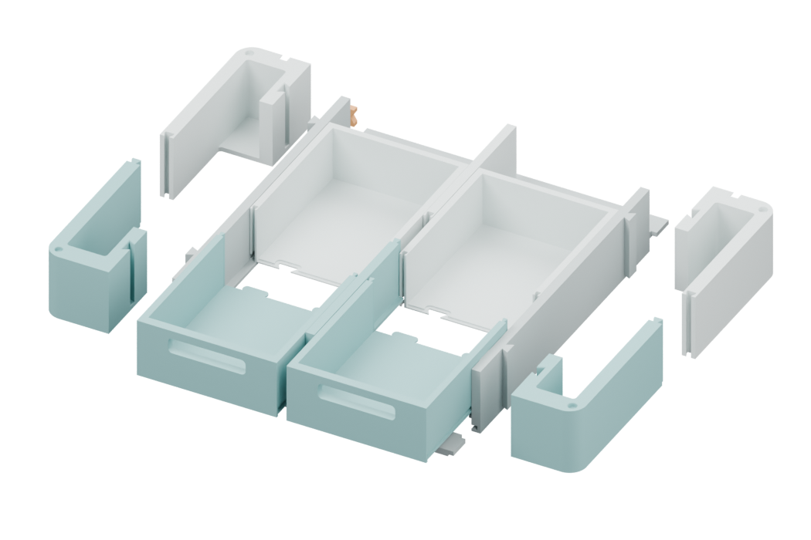

# ams2pro/2-drawer-layer · 256 mm

先将同编号的前段 a 与后段 b 错开高度，对准燕尾后竖直合拢。图中前段为青色，后段为浅灰色。J 是整根横梁。

Match the number, align the front (a) and rear (b) tails, then lower one section into the other. Front sections are teal and rear sections light grey. J identifies a one-piece beam.

[装配模型 / Assembly](layer-assembly.glb)

| 打印编号 / Print ID | 装配编号 / Assembly ID | STL |
| --- | --- | --- |
| ND01a | ND01 | [ND01a.stl](ND01a.stl) |
| ND01b | ND01 | [ND01b.stl](ND01b.stl) |
| ND02a | ND02 | [ND02a.stl](ND02a.stl) |
| ND02b | ND02 | [ND02b.stl](ND02b.stl) |
| ND03 | ND03 | [side_left.stl](../../../ams2pro/2-drawer-layer/side_left.stl) |
| ND04 | ND04 | [side_right.stl](../../../ams2pro/2-drawer-layer/side_right.stl) |
| ND05a | ND05 | [ND05a.stl](ND05a.stl) |
| ND05b | ND05 | [ND05b.stl](ND05b.stl) |
| ND06J | ND06, ND07 | [ND06J.stl](ND06J.stl) |
| ND08J | ND08, ND09 | [ND08J.stl](ND08J.stl) |
| ND10a | ND10 | [ND10a.stl](ND10a.stl) |
| ND10b | ND10 | [ND10b.stl](ND10b.stl) |
| ND11a | ND11 | [ND11a.stl](ND11a.stl) |
| ND11b | ND11 | [ND11b.stl](ND11b.stl) |
| ND12 | ND12 | [rear-lock.stl](../../../common/rear-lock.stl) |
| ND13 | ND13 | [rear-lock.stl](../../../common/rear-lock.stl) |
