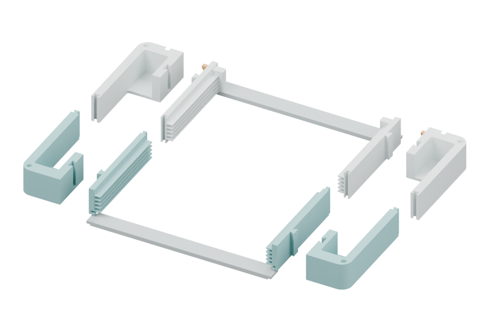

# ams2pro/5-slot-plate-layer · 256 mm

先将同编号的前段 a 与后段 b 错开高度，对准燕尾后竖直合拢。图中前段为青色，后段为浅灰色。J 是整根横梁。

Match the number, align the front (a) and rear (b) tails, then lower one section into the other. Front sections are teal and rear sections light grey. J identifies a one-piece beam.

[装配模型 / Assembly](layer-assembly.glb)

| 打印编号 / Print ID | 装配编号 / Assembly ID | STL |
| --- | --- | --- |
| NA01a | NA01 | [NA01a.stl](NA01a.stl) |
| NA01b | NA01 | [NA01b.stl](NA01b.stl) |
| NA02a | NA02 | [NA02a.stl](NA02a.stl) |
| NA02b | NA02 | [NA02b.stl](NA02b.stl) |
| NA03a | NA03 | [NA03a.stl](NA03a.stl) |
| NA03b | NA03 | [NA03b.stl](NA03b.stl) |
| NA04a | NA04 | [NA04a.stl](NA04a.stl) |
| NA04b | NA04 | [NA04b.stl](NA04b.stl) |
| NA05J | NA05, NA06 | [NA05J.stl](NA05J.stl) |
| NA07J | NA07, NA08 | [NA07J.stl](NA07J.stl) |
| KEY-left | KEY-left | [rear-lock.stl](../../../common/rear-lock.stl) |
| KEY-right | KEY-right | [rear-lock.stl](../../../common/rear-lock.stl) |
