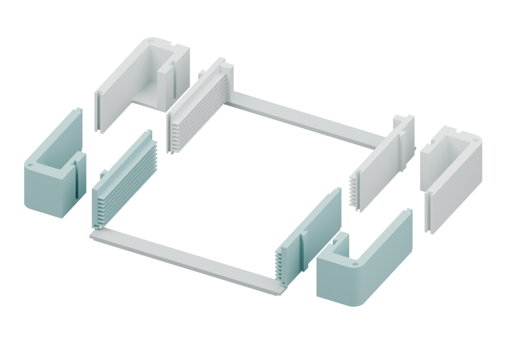

# ams2pro/8-slot-plate-layer · 256 mm

先将同编号的前段 a 与后段 b 错开高度，对准燕尾后竖直合拢。图中前段为青色，后段为浅灰色。J 是整根横梁。

Match the number, align the front (a) and rear (b) tails, then lower one section into the other. Front sections are teal and rear sections light grey. J identifies a one-piece beam.

[装配模型 / Assembly](layer-assembly.glb)

| 打印编号 / Print ID | 装配编号 / Assembly ID | STL |
| --- | --- | --- |
| NB01a | NB01 | [NB01a.stl](NB01a.stl) |
| NB01b | NB01 | [NB01b.stl](NB01b.stl) |
| NB02a | NB02 | [NB02a.stl](NB02a.stl) |
| NB02b | NB02 | [NB02b.stl](NB02b.stl) |
| NB03a | NB03 | [NB03a.stl](NB03a.stl) |
| NB03b | NB03 | [NB03b.stl](NB03b.stl) |
| NB04a | NB04 | [NB04a.stl](NB04a.stl) |
| NB04b | NB04 | [NB04b.stl](NB04b.stl) |
| NB05J | NB05, NB06 | [NB05J.stl](NB05J.stl) |
| NB07J | NB07, NB08 | [NB07J.stl](NB07J.stl) |
| NB09 | NB09 | [rear-lock.stl](../../../common/rear-lock.stl) |
| NB10 | NB10 | [rear-lock.stl](../../../common/rear-lock.stl) |
