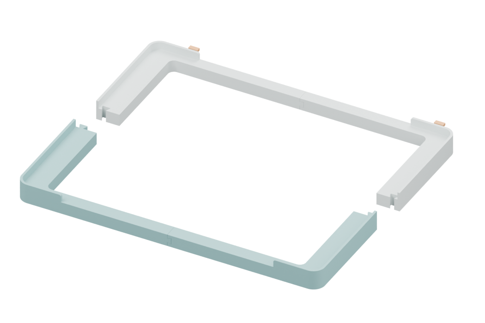

# ams2pro/device-top · 256 mm

先将同编号的前段 a 与后段 b 错开高度，对准燕尾后竖直合拢。图中前段为青色，后段为浅灰色。J 是整根横梁。

Match the number, align the front (a) and rear (b) tails, then lower one section into the other. Front sections are teal and rear sections light grey. J identifies a one-piece beam.

[装配模型 / Assembly](layer-assembly.glb)

| 打印编号 / Print ID | 装配编号 / Assembly ID | STL |
| --- | --- | --- |
| NE01a | NE01 | [NE01a.stl](NE01a.stl) |
| NE01b | NE01 | [NE01b.stl](NE01b.stl) |
| NE02a | NE02 | [NE02a.stl](NE02a.stl) |
| NE02b | NE02 | [NE02b.stl](NE02b.stl) |
| NE03 | NE03 | [rear-lock.stl](../../../common/rear-lock.stl) |
| NE04 | NE04 | [rear-lock.stl](../../../common/rear-lock.stl) |
