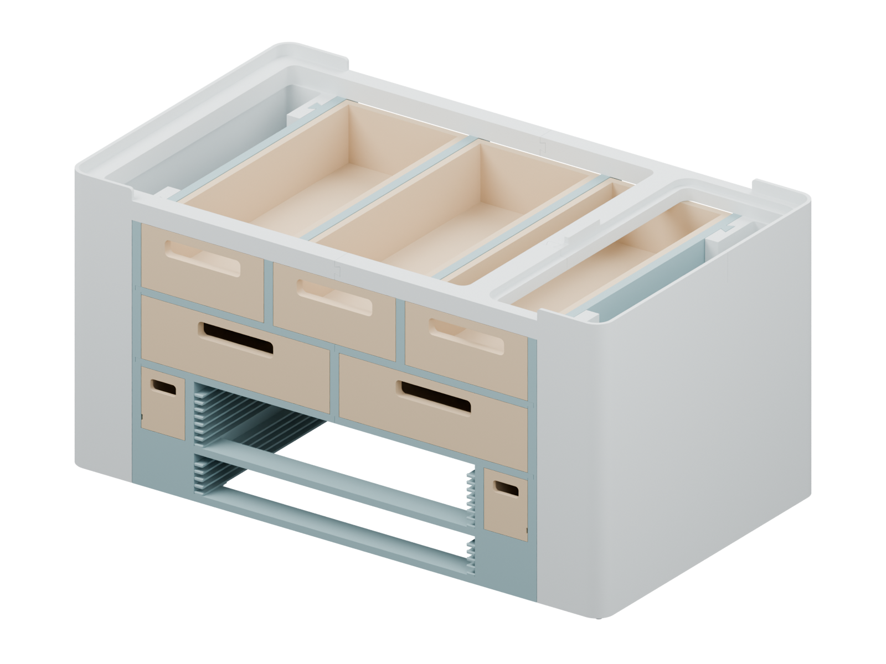
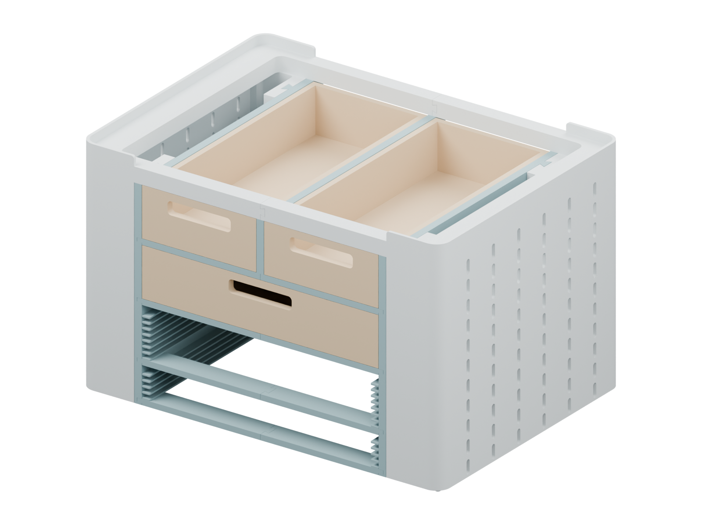
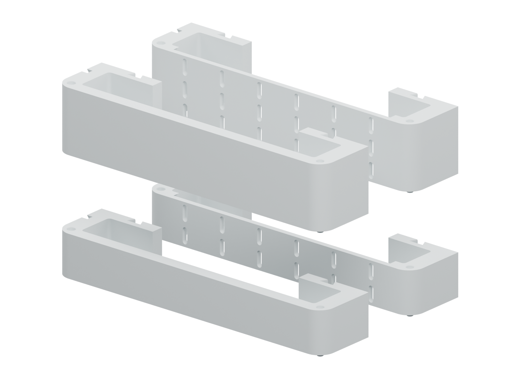

# Overstack models / 模型下载

两种宽度共用同一款尾部蝴蝶锁片，每道层缝两片。 / Both widths use two copies of the same rear bowtie per seam. [平放 STL / Rear key STL](common/rear-lock.stl)

**打印板适配：当前所有五槽／八槽板架仅针对 256 × 256 mm 打印面积规格的拓竹板设计，适用机型为 A1、P1P、P1S、P2S、X1、X1 Carbon（X1C）、X1E 和 X2D。** 不支持 A1 mini 或 H 系列板。256 × 256 mm 是打印面积，不是钢板完整外形；第三方板需另核外形与厚度，当前模型尚未实物试装。

**Build plate compatibility: all current five- and eight-slot racks are designed only for Bambu plates in the 256 × 256 mm printable-area class: A1, P1P, P1S, P2S, X1, X1 Carbon (X1C), X1E and X2D.** A1 mini and H-series plates are not supported. 256 × 256 mm describes the printable area, not the full steel-sheet outline. Check third-party plate outlines and thickness separately; physical fit has not been tested.

| 目录 / Directory | 预览 / Preview | 用途 / Contents |
| --- | --- | --- |
| [ams2pro+ht](ams2pro+ht/) |  | AMS 2 Pro + HT，495 × 287 mm；双抽屉或三抽屉 / double or triple drawers |
| [ams2pro](ams2pro/) |  | 仅 AMS 2 Pro，399 × 287 mm；只含单／双抽屉 / single and double drawers only |
| [common](common/) |  | 两种规格共用的普通／洞洞板端框、锁片和试配板 / shared plain and pegboard ends, keys and fit coupon |

先选设备组合，再选层数与中段。相同高度端框通用，整层和顶件不能跨宽度混搭。
Choose the device set first, then the layers. Same-height ends are shared; whole layers and tops must match width.

[接口试配小件 / Interface fit specimens](fit-check/) · [Bambu Studio 摆盘工程 / Print profiles](../print-profiles/)
