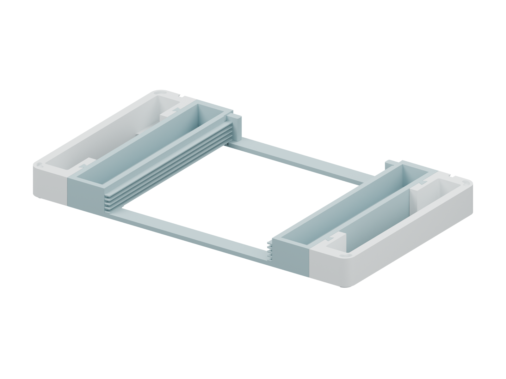
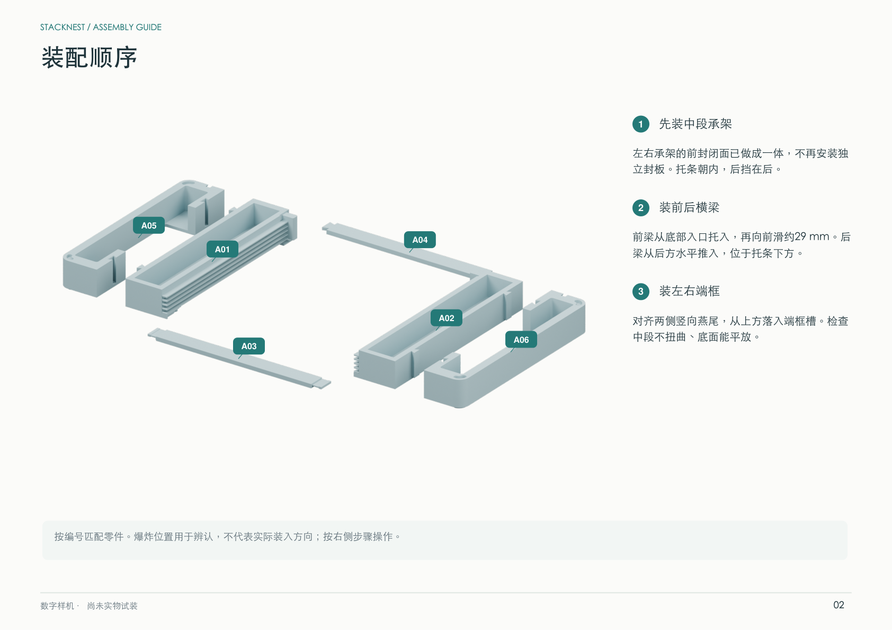

# 01-five-slot-plate-layer

40 mm 层高，5 个板位，槽距 6 mm；按板厚最大 1.5 mm 预留，顶槽上方净空 7 mm。 / 40 mm layer, 5 plate slots at 6 mm pitch, allowing up to 1.5 mm plate thickness with 7 mm top clearance.

**打印板适配：当前所有五槽／八槽板架仅针对 256 × 256 mm 打印面积规格的拓竹板设计，适用机型为 A1、P1P、P1S、P2S、X1、X1 Carbon（X1C）、X1E 和 X2D。** 不支持 A1 mini 或 H 系列板。256 × 256 mm 是打印面积，不是钢板完整外形；第三方板需另核外形与厚度，当前模型尚未实物试装。

**Build plate compatibility: all current five- and eight-slot racks are designed only for Bambu plates in the 256 × 256 mm printable-area class: A1, P1P, P1S, P2S, X1, X1 Carbon (X1C), X1E and X2D.** A1 mini and H-series plates are not supported. 256 × 256 mm describes the printable area, not the full steel-sheet outline. Check third-party plate outlines and thickness separately; physical fit has not been tested.

## 零件编号 / Part IDs

编号对应下方爆炸图和 STL 文件名；点击编号下载对应零件。左右以面对抽屉／打印板入口为准。

Match the IDs in the exploded view to the STL filenames. Click an ID to download that part. Left and right are viewed from the front opening.

| 编号 / ID | 零件 |
| --- | --- |
| [A01](parts/A01-low_0_cassette_plates_1.stl) | 左侧承架 |
| [A02](parts/A02-low_0_cassette_plates_2.stl) | 右侧承架 |
| [A03](parts/A03-low_0_cassette_plates_3.stl) | 前横梁 |
| [A04](parts/A04-low_0_cassette_plates_4.stl) | 后横梁 |
| [A05](parts/A05-low_0_end_left_1.stl) | 左端框 |
| [A06](parts/A06-low_0_end_right_1.stl) | 右端框 |

[中文组装教程](../../../docs/pdf/01-five-slot-plate-layer-assembly-zh.pdf) · [English assembly guide](../../../docs/pdf/01-five-slot-plate-layer-assembly-en.pdf)

STL单位毫米。3MF为装配几何，不含打印机配置，不是可直接发送的切片文件。零件未摆盘，切片前需调整方向与支撑。
