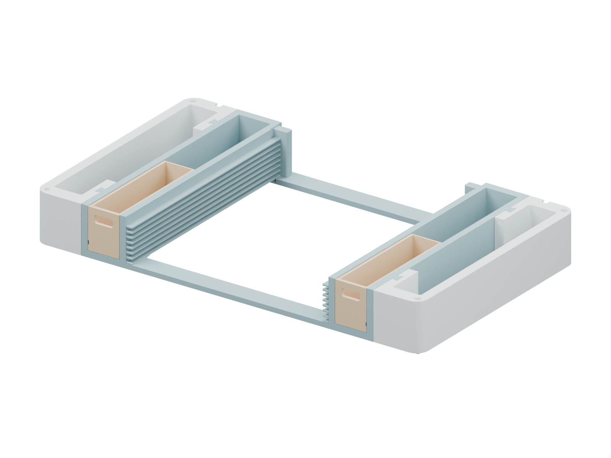
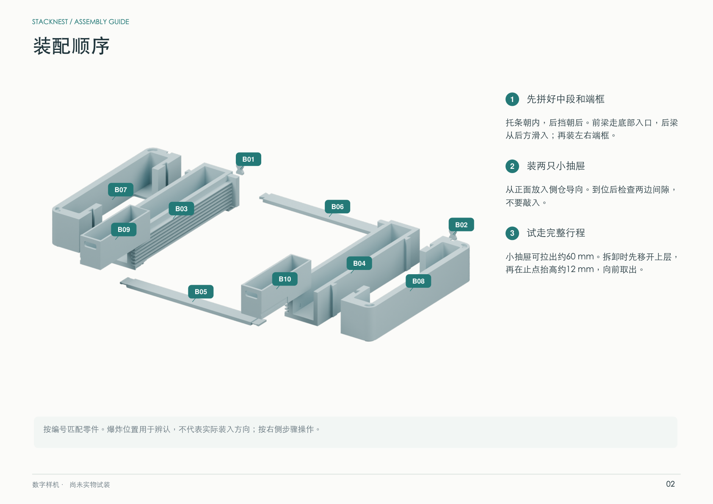

# 02-eight-slot-plate-layer

## 零件编号 / Part IDs

编号对应下方爆炸图和 STL 文件名；点击编号下载对应零件。左右以面对抽屉／打印板入口为准。

Match the IDs in the exploded view to the STL filenames. Click an ID to download that part. Left and right are viewed from the front opening.

| 编号 / ID | 零件 |
| --- | --- |
| [B01](parts/B01-seam_1_False_layer_lock.stl) | 层间锁片 |
| [B02](parts/B02-seam_1_True_layer_lock.stl) | 层间锁片 |
| [B03](parts/B03-standard_1_cassette_plates_1.stl) | 左侧承架 |
| [B04](parts/B04-standard_1_cassette_plates_2.stl) | 右侧承架 |
| [B05](parts/B05-standard_1_cassette_plates_3.stl) | 前横梁 |
| [B06](parts/B06-standard_1_cassette_plates_4.stl) | 后横梁 |
| [B07](parts/B07-standard_1_end_left_1.stl) | 左端框 |
| [B08](parts/B08-standard_1_end_right_1.stl) | 右端框 |
| [B09](parts/B09-standard_1_side_bin_left_1.stl) | 左小抽屉 |
| [B10](parts/B10-standard_1_side_bin_right_1.stl) | 右小抽屉 |

[中文组装教程](../../../docs/pdf/02-eight-slot-plate-layer-assembly-zh.pdf) · [English assembly guide](../../../docs/pdf/02-eight-slot-plate-layer-assembly-en.pdf)

STL单位毫米。3MF为装配几何，不含打印机配置，不是可直接发送的切片文件。零件未摆盘，切片前需调整方向与支撑。
