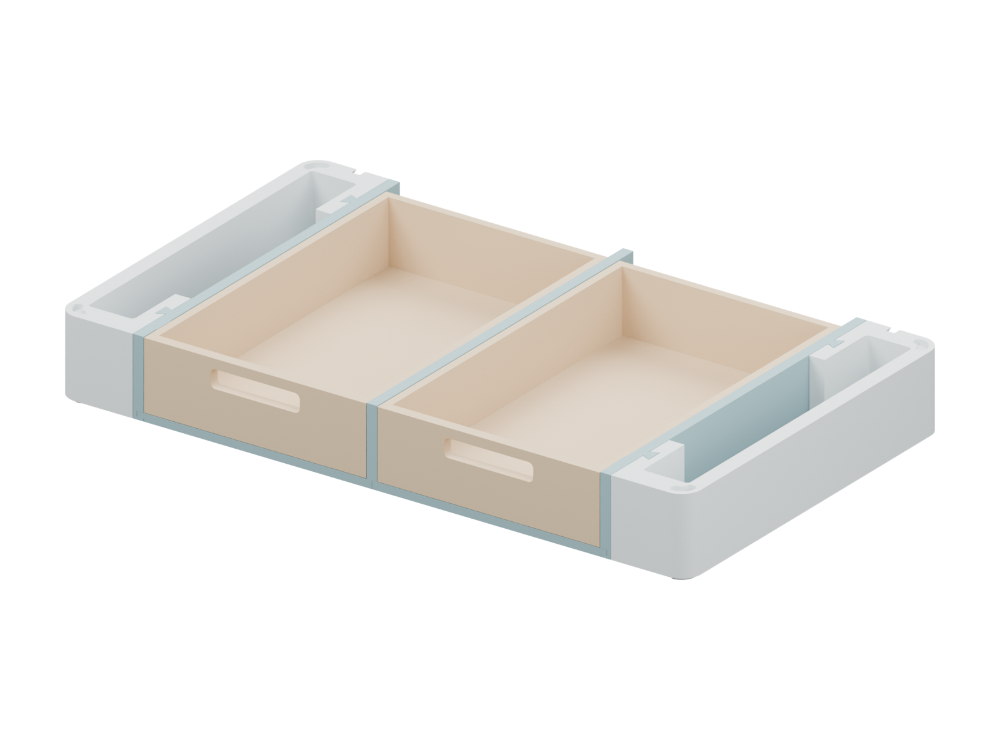

# 04-double-drawer-layer

- D01 隔墙
- D02 抽屉1
- D03 抽屉2
- D04 左端框
- D05 右端框
- D06 前横梁
- D07 前横梁
- D08 后横梁
- D09 后横梁
- D10 层间锁片
- D11 层间锁片
- D12 左侧承架
- D13 右侧承架

STL单位毫米。3MF为装配几何，不含打印机配置，不是可直接发送的切片文件。零件未摆盘，切片前需调整方向与支撑。
