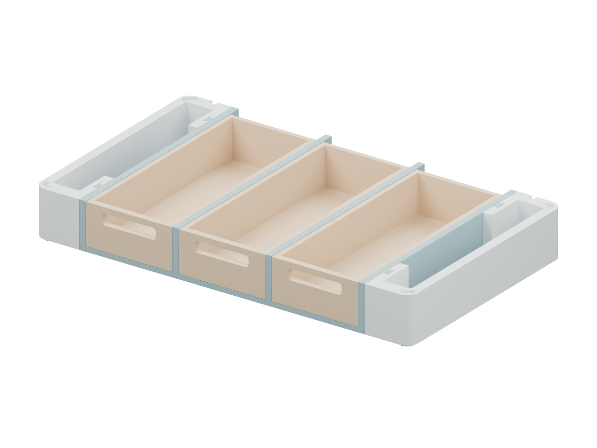

# 05-triple-drawer-layer

- E01 隔墙
- E02 隔墙
- E03 抽屉1
- E04 抽屉2
- E05 抽屉3
- E06 左端框
- E07 右端框
- E08 前横梁
- E09 前横梁
- E10 后横梁
- E11 后横梁
- E12 层间锁片
- E13 层间锁片
- E14 左侧承架
- E15 右侧承架

STL单位毫米。3MF为装配几何，不含打印机配置，不是可直接发送的切片文件。零件未摆盘，切片前需调整方向与支撑。
