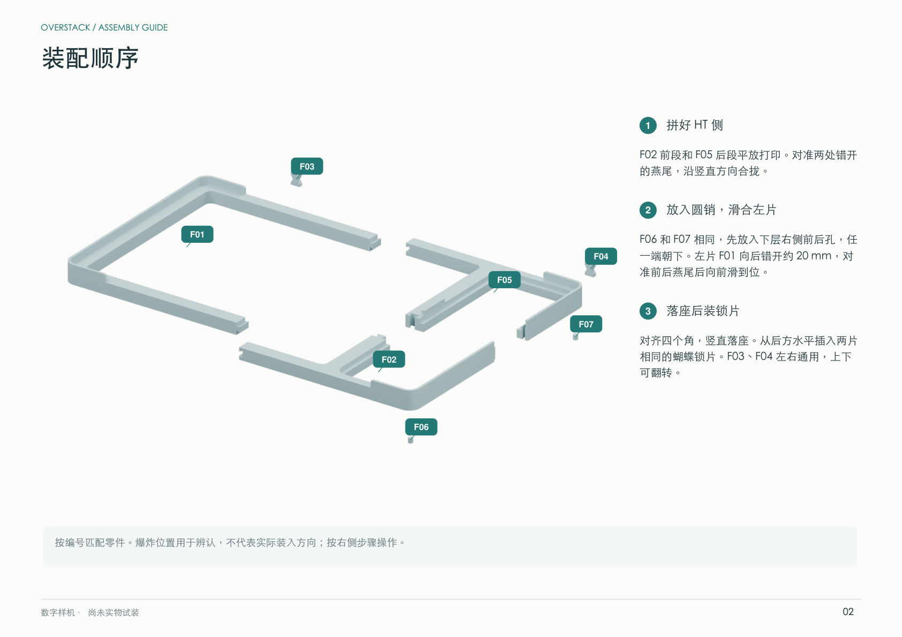

# 06-device-top

[HT 侧试印与切片对照 / HT-side test print and slice comparison](../../../docs/ht-top-printing.md)

HT 侧替换套含 F02、F04、F05、F06、F07。前后段底面贴板，两只相同的 Ø6 圆销端面贴板，通用蝴蝶形锁片大面贴板。把 F02 与 F05 的两处燕尾竖直合拢，再把两只圆销放入下层右侧前后孔。顶件落座后，从后面水平推入锁片。左右位置 F03、F04 使用同一种锁片，上下可翻转。

The HT-side replacement includes F02, F04, F05, F06 and F07. Print both sections flat, the identical round dowels on end and the common bowtie key on its broad face. Join the staggered dovetails vertically and place the dowels in the lower frame. Seat the top and slide one bowtie into each rear slot. F03 and F04 are interchangeable, either end up.

两端挡边的四个外露上角已做 R3 mm 圆角，承托面和连接接口不变；打印后仍需检查毛刺。 / The four exposed upper lip ends have R3 mm rounds; bearing faces and joints are unchanged. Check printed parts for burrs.

## 零件编号 / Part IDs

编号对应下方爆炸图和 STL 文件名；点击编号下载对应零件。左右以面对抽屉／打印板入口为准。

Match the IDs in the exploded view to the STL filenames. Click an ID to download that part. Left and right are viewed from the front opening.

每道层缝从后方插入两片相同的蝴蝶锁片，左右通用。 / Print two identical bowties per seam. Either fits either side. [通用锁片 STL / Rear key STL](../../common/rear-lock.stl)

| 编号 / ID | 零件 |
| --- | --- |
| [F01](parts/F01-device_adapter_1.stl) | 顶部左片 |
| [F02](parts/F02-device_adapter_2.stl) | HT 前段 |
| [F03](../../common/rear-lock.stl) | 层间锁片 |
| [F04](../../common/rear-lock.stl) | 层间锁片 |
| [F05](parts/F05-ht_top_rear.stl) | HT 后段 |
| [F06](parts/F06-ht_foot_front.stl) | HT 前定位脚 |
| [F07](parts/F07-ht_foot_rear.stl) | HT 后定位脚 |

[中文组装教程](../../../docs/pdf/06-device-top-assembly-zh.pdf) · [English assembly guide](../../../docs/pdf/06-device-top-assembly-en.pdf)

STL单位毫米。3MF为装配几何，不含打印机配置，不是可直接发送的切片文件。零件未摆盘，切片前需调整方向与支撑。
