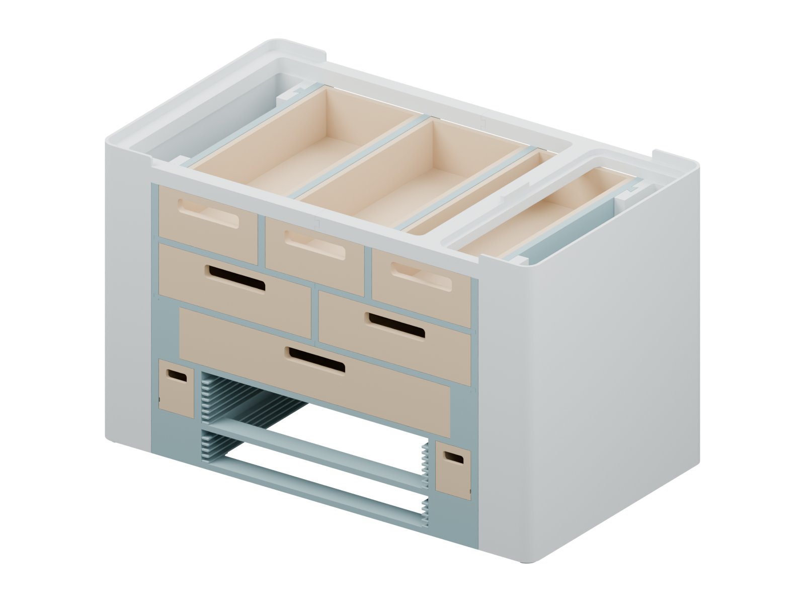

# AMS 2 Pro + HT

**打印板适配：当前所有五槽／八槽板架仅针对 256 × 256 mm 打印面积规格的拓竹板设计，适用机型为 A1、P1P、P1S、P2S、X1、X1 Carbon（X1C）、X1E 和 X2D。** 不支持 A1 mini 或 H 系列板。256 × 256 mm 是打印面积，不是钢板完整外形；第三方板需另核外形与厚度，当前模型尚未实物试装。

**Build plate compatibility: all current five- and eight-slot racks are designed only for Bambu plates in the 256 × 256 mm printable-area class: A1, P1P, P1S, P2S, X1, X1 Carbon (X1C), X1E and X2D.** A1 mini and H-series plates are not supported. 256 × 256 mm describes the printable area, not the full steel-sheet outline. Check third-party plate outlines and thickness separately; physical fit has not been tested.

[Common ends / 通用端框](../common/) · [Pegboard assembly GLB](stacknest-pegboard.glb) · [Assembly guides / 组装教程](../../docs/pdf/)

[Complete assembly GLB](stacknest-assembly.glb) · [Part manifest](parts.json)

| Layer | Parts |
| --- | ---: |
| [01-five-slot-plate-layer](01-five-slot-plate-layer/) | 6 |
| [02-eight-slot-plate-layer](02-eight-slot-plate-layer/) | 10 |
| [03-single-drawer-layer](03-single-drawer-layer/) | 10 |
| [04-double-drawer-layer](04-double-drawer-layer/) | 13 |
| [05-triple-drawer-layer](05-triple-drawer-layer/) | 15 |
| [06-device-top](06-device-top/) | 4 |

58 STL parts, six layer GLBs, six geometry-only 3MF assemblies and one complete GLB. Filenames match the assembly-guide part IDs.

This is an unprinted digital prototype. Models are in assembly positions; orient and support parts before slicing. See [validation](validation.json) for known limits.

All eight drawers have 2 mm solid floors; joining and slide interfaces are retained.

## H2D / H2S large-plate option / 大板版

本次不提供大板版。保持现有 495 × 287 mm 底座外形时，287 mm 深度连 H2D/H2S 的 320 mm 打印区域短边都容纳不下，更不用说完整钢板；旋转 90° 也不能完整收纳。移除侧收纳盒只能增加宽度，不能解决深度不足。外伸式承架或加深底座不在本次范围内。

No large-plate variant is included. Within the existing 495 × 287 mm footprint, the 287 mm depth is smaller than even the 320 mm short side of the H2D/H2S printable area, before accounting for the full sheet outline. Rotating the plate does not allow full containment. Removing the side bins only frees width. Overhanging carriers and a deeper base are outside this revision.

[H2D dimensions / 官方尺寸](https://csm.bblcdn.com/hub/4668d0ca43994ff3bff4b37f1a65c2e7.pdf) · [Plate families / 板材适配型号](https://biqu.equipment/products/biqu-panda-buildplate-cryogrip-pro)
