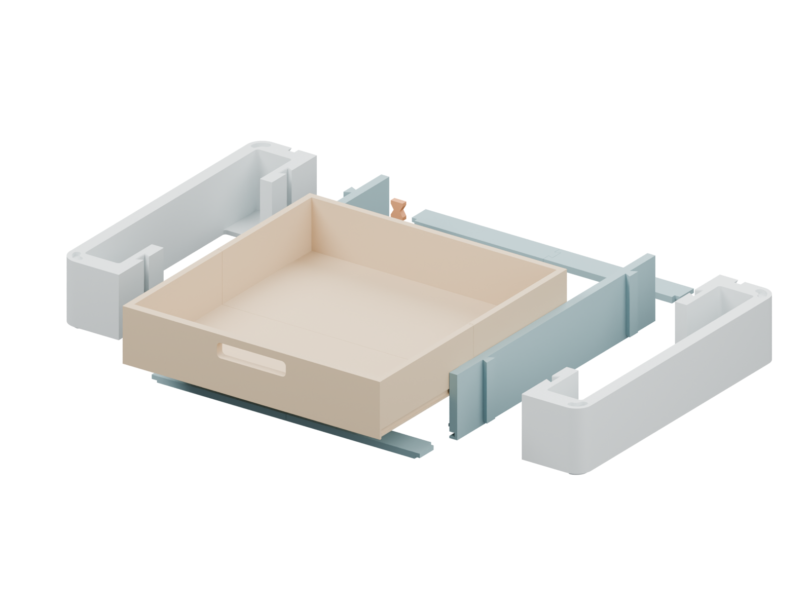

# 单抽屉层 / Single-drawer layer

60 mm；抽屉外宽 261 mm、内宽 249 mm，2 mm 实心底。前后两半通过两侧壁的竖向燕尾拼合；平整承托后向下合拢，不能沿抽拉方向硬压。 / 60 mm; 261 mm outer / 249 mm inner drawer width and a 2 mm floor. Lower the front half onto the rear half through the vertical wall dovetails before installing the drawer.

[GLB](layer-assembly.glb) · [Geometry 3MF](layer-assembly-geometry.3mf) · [BOM](parts.json)

| Part | STL | X offset in this layer |
| --- | --- | ---: |
| end_left_1 | [Download](../../common/end_left_60_plain.stl) | 0 mm |
| end_right_1 | [Download](../../common/end_right_60_plain.stl) | -96 mm |
| side_left | [Download](side_left.stl) | 0 mm |
| side_right | [Download](side_right.stl) | 0 mm |
| front_beam_1 | [Download](front_beam_1.stl) | 0 mm |
| front_beam_2 | [Download](front_beam_2.stl) | 0 mm |
| rear_beam_1 | [Download](rear_beam_1.stl) | 0 mm |
| rear_beam_2 | [Download](rear_beam_2.stl) | 0 mm |
| drawer_half_1 | [Download](drawer_half_1.stl) | 0 mm |
| drawer_half_2 | [Download](drawer_half_2.stl) | 0 mm |
| lock_left | [Download](../../common/lock_left.stl) | 0 mm |
| lock_right | [Download](../../common/lock_right.stl) | -96 mm |

两端和锁片直接引用通用件。右件保持 HT 版导出坐标，在此装配中向左移动 96 mm；切片前将每件单独落到平台。3MF 是装配几何，不是打印任务。

Common ends and keys are referenced, not duplicated. Right-hand common files retain wide-set coordinates; the assembly moves them left by 96 mm. Reorient and place each part on the bed before slicing. The 3MF is assembly geometry, not a print job.

抽屉行程 180 mm，到止点抬高 7 mm 后取出；先移走设备与上层。 / Drawer travel: 180 mm; lift 7 mm at the stop for removal, with devices and upper layers removed.
