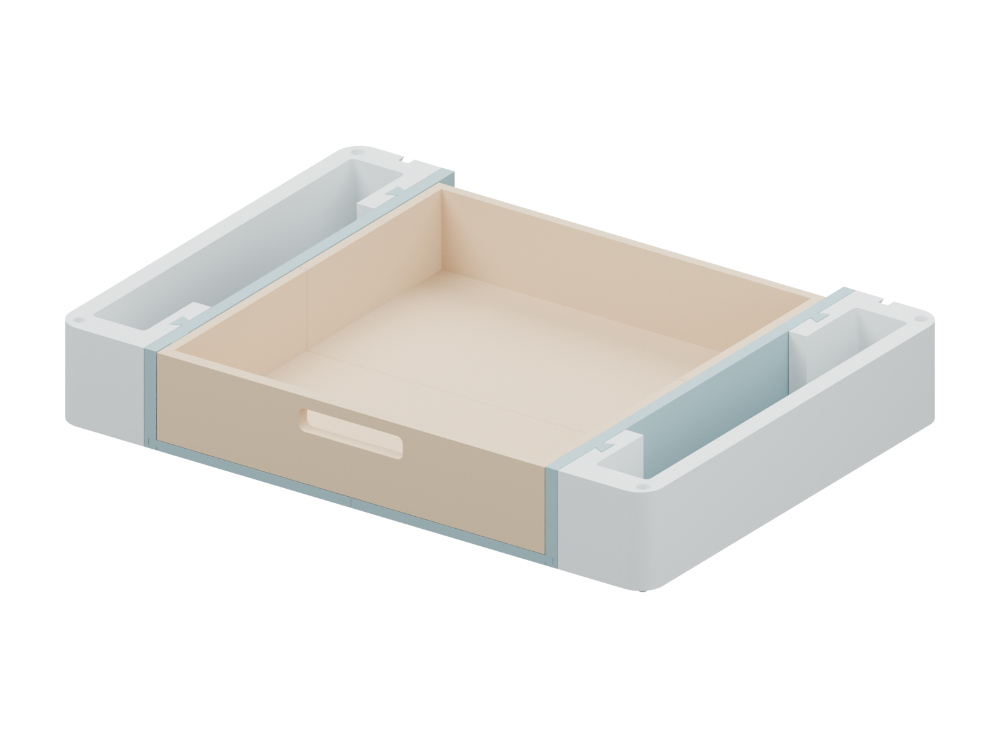
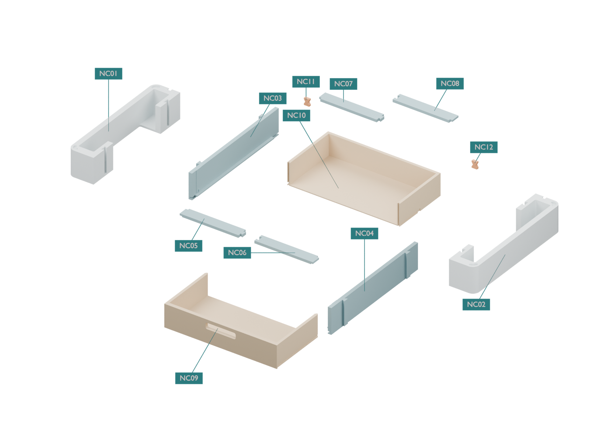

# 单抽屉层 / Single-drawer layer

60 mm；抽屉外宽 261 mm、内宽 249 mm，2 mm 实心底。前后两半通过两侧壁的竖向燕尾拼合；平整承托后向下合拢，不能沿抽拉方向硬压。 / 60 mm; 261 mm outer / 249 mm inner drawer width and a 2 mm floor. Lower the front half onto the rear half through the vertical wall dovetails before installing the drawer.

编号与下表一一对应；左右以面对入口为准。爆炸图只用于辨认零件，不代表装入方向。

Match each callout to its table row. Left/right are viewed from the front. Exploded positions identify parts, not insertion directions.

[GLB](layer-assembly.glb) · [Geometry 3MF](layer-assembly-geometry.3mf) · [BOM](parts.json)

| 编号 / ID | 零件 | STL | X offset |
| --- | --- | --- | ---: |
| [NC01](../../common/end_left_60_plain.stl) | 左端框 | `end_left_60_plain.stl` | 0 mm |
| [NC02](../../common/end_right_60_plain.stl) | 右端框 | `end_right_60_plain.stl` | -96 mm |
| [NC03](side_left.stl) | 左抽屉承架 | `side_left.stl` | 0 mm |
| [NC04](side_right.stl) | 右抽屉承架 | `side_right.stl` | 0 mm |
| [NC05](front_beam_1.stl) | 前横梁左半 | `front_beam_1.stl` | 0 mm |
| [NC06](front_beam_2.stl) | 前横梁右半 | `front_beam_2.stl` | 0 mm |
| [NC07](rear_beam_1.stl) | 后横梁左半 | `rear_beam_1.stl` | 0 mm |
| [NC08](rear_beam_2.stl) | 后横梁右半 | `rear_beam_2.stl` | 0 mm |
| [NC09](drawer_half_1.stl) | 抽屉前半 | `drawer_half_1.stl` | 0 mm |
| [NC10](drawer_half_2.stl) | 抽屉后半 | `drawer_half_2.stl` | 0 mm |
| [NC11](../../common/rear-lock.stl) | 通用蝴蝶锁片 | `rear-lock.stl` | 见装配清单 / see BOM |
| [NC12](../../common/rear-lock.stl) | 通用蝴蝶锁片 | `rear-lock.stl` | 见装配清单 / see BOM |

右端框在 399 mm 装配中向左移动 96 mm。每道层缝左右各装一片相同的蝴蝶锁片，可直接平放补打。[通用锁片 STL](../../common/rear-lock.stl)

The compact assembly moves the right end frame 96 mm to the left. Print two copies of the same flat bowtie for each seam. The 3MF in this folder shows the assembled layer.

抽屉行程 180 mm，到止点抬高 7 mm 后取出；先移走设备与上层。 / Drawer travel: 180 mm; lift 7 mm at the stop for removal, with devices and upper layers removed.
