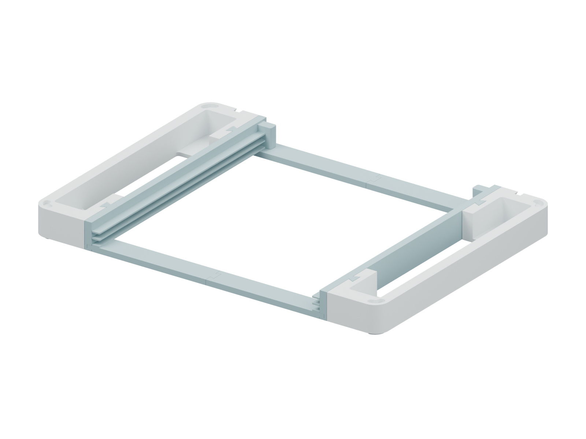
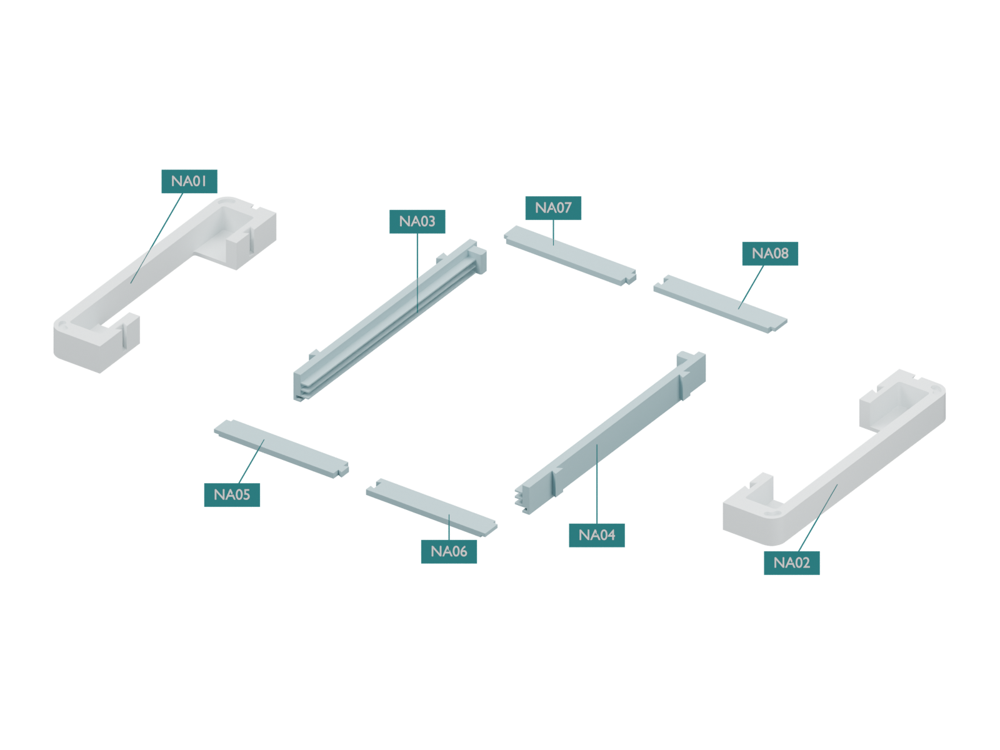

# 三槽打印板层 / Three-slot plate layer

**打印板适配：当前所有三槽／八槽板架仅针对 256 × 256 mm 打印面积规格的拓竹板设计，适用机型为 A1、P1P、P1S、P2S、X1、X1 Carbon（X1C）、X1E 和 X2D。** 不支持 A1 mini 或 H 系列板。256 × 256 mm 是打印面积，不是钢板完整外形；第三方板需另核外形与厚度，当前模型尚未实物试装。

**Build plate compatibility: all current three- and eight-slot racks are designed only for Bambu plates in the 256 × 256 mm printable-area class: A1, P1P, P1S, P2S, X1, X1 Carbon (X1C), X1E and X2D.** A1 mini and H-series plates are not supported. 256 × 256 mm describes the printable area, not the full steel-sheet outline. Check third-party plate outlines and thickness separately; physical fit has not been tested.

30 mm；三片板，两只通用端框、两只托架、四片横梁。无侧抽屉。 / 30 mm, three plates, common ends and four beam halves. No side bins.

编号与下表一一对应；左右以面对入口为准。爆炸图只用于辨认零件，不代表装入方向。

Match each callout to its table row. Left/right are viewed from the front. Exploded positions identify parts, not insertion directions.

[GLB](layer-assembly.glb) · [Geometry 3MF](layer-assembly-geometry.3mf) · [BOM](parts.json)

| 编号 / ID | 零件 | STL | X offset |
| --- | --- | --- | ---: |
| [NA01](../../common/end_left_30_plain.stl) | 左端框 | `end_left_30_plain.stl` | 0 mm |
| [NA02](../../common/end_right_30_plain.stl) | 右端框 | `end_right_30_plain.stl` | -96 mm |
| [NA03](plate_carrier_left.stl) | 左板托架 | `plate_carrier_left.stl` | 0 mm |
| [NA04](plate_carrier_right.stl) | 右板托架 | `plate_carrier_right.stl` | 0 mm |
| [NA05](front_beam_1.stl) | 前横梁左半 | `front_beam_1.stl` | 0 mm |
| [NA06](front_beam_2.stl) | 前横梁右半 | `front_beam_2.stl` | 0 mm |
| [NA07](rear_beam_1.stl) | 后横梁左半 | `rear_beam_1.stl` | 0 mm |
| [NA08](rear_beam_2.stl) | 后横梁右半 | `rear_beam_2.stl` | 0 mm |

两端和锁片直接引用通用件。右件保持 HT 版导出坐标，在此装配中向左移动 96 mm；切片前将每件单独落到平台。3MF 是装配几何，不是打印任务。

Common ends and keys are referenced, not duplicated. Right-hand common files retain wide-set coordinates; the assembly moves them left by 96 mm. Reorient and place each part on the bed before slicing. The 3MF is assembly geometry, not a print job.

板宽标称 258 mm；入口朝前，后挡定位。前后横梁先在中部拼接，再分别从前后滑入端部托架。托架及端框从上方配合。 / Nominal plate width: 258 mm. The rear stops locate the plate. Join each beam at its centre, slide front/rear beams into their carrier sockets, and lower the carriers into the end-frame dovetails.
