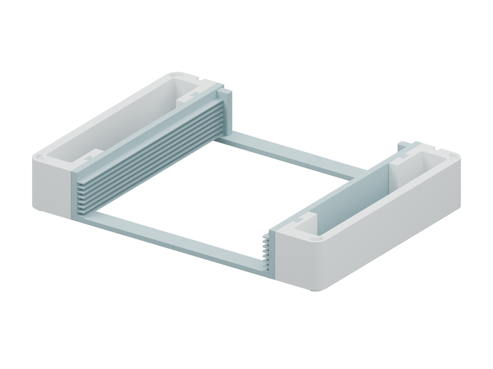
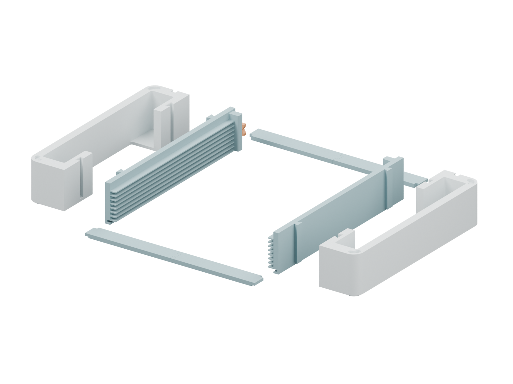

# 八槽打印板层 / Eight-slot plate layer

60 mm；八片板，无侧抽屉。含下接缝的两枚锁片，作底层时不装这两枚。 / 60 mm, eight plates, no side bins. Omit lower seam keys when this is the bottom layer.

[GLB](layer-assembly.glb) · [Geometry 3MF](layer-assembly-geometry.3mf) · [BOM](parts.json)

| Part | STL | X offset in this layer |
| --- | --- | ---: |
| end_left | [Download](../../common/end_left_60_plain.stl) | 0 mm |
| end_right | [Download](../../common/end_right_60_plain.stl) | -96 mm |
| plate_carrier_left | [Download](plate_carrier_left.stl) | 0 mm |
| plate_carrier_right | [Download](plate_carrier_right.stl) | 0 mm |
| front_beam_1 | [Download](front_beam_1.stl) | 0 mm |
| front_beam_2 | [Download](front_beam_2.stl) | 0 mm |
| rear_beam_1 | [Download](rear_beam_1.stl) | 0 mm |
| rear_beam_2 | [Download](rear_beam_2.stl) | 0 mm |
| lock_left | [Download](../../common/lock_left.stl) | 0 mm |
| lock_right | [Download](../../common/lock_right.stl) | -96 mm |

两端和锁片直接引用通用件。右件保持 HT 版导出坐标，在此装配中向左移动 96 mm；切片前将每件单独落到平台。3MF 是装配几何，不是打印任务。

Common ends and keys are referenced, not duplicated. Right-hand common files retain wide-set coordinates; the assembly moves them left by 96 mm. Reorient and place each part on the bed before slicing. The 3MF is assembly geometry, not a print job.

板宽标称 258 mm；入口朝前，后挡定位。前后横梁先在中部拼接，再分别从前后滑入端部托架。托架及端框从上方配合。 / Nominal plate width: 258 mm. The rear stops locate the plate. Join each beam at its centre, slide front/rear beams into their carrier sockets, and lower the carriers into the end-frame dovetails.
