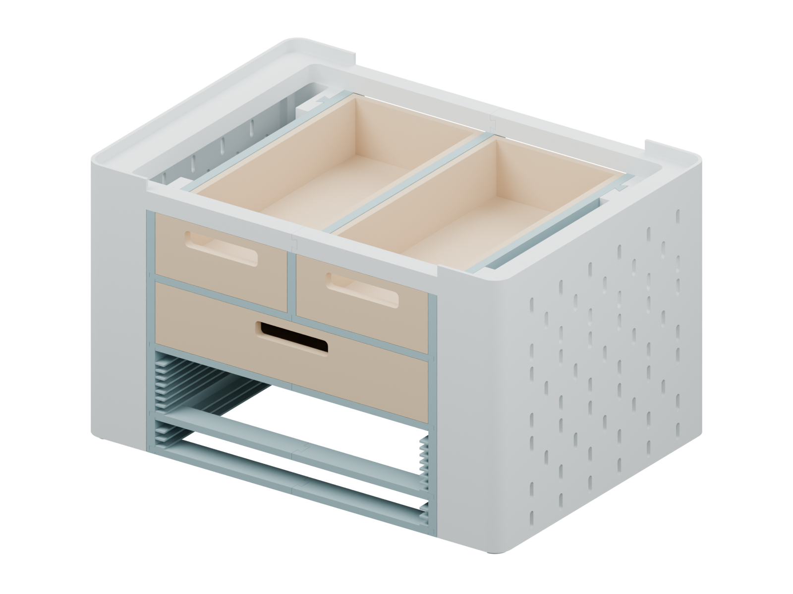

# 无 HT 版 / AMS 2 Pro only

399 × 287 mm。三槽／八槽板层，单／双抽屉；没有三抽屉，没有侧抽屉，没有 HT 开口。

399 × 287 mm. Three/eight-slot plate layers, single/double drawers. No triple drawer, side bins or HT opening.

[Plain assembly GLB](stacknest-no-ht.glb) · [Pegboard assembly GLB](stacknest-no-ht-pegboard.glb) · [Common ends](../common/)

| Layer | Height increment | Assembly parts |
| --- | ---: | ---: |
| [三槽打印板层 / Three-slot plate layer](3-slot-plate-layer/) | 30 mm | 8 |
| [八槽打印板层 / Eight-slot plate layer](8-slot-plate-layer/) | 60 mm | 10 |
| [单抽屉层 / Single-drawer layer](1-drawer-layer/) | 60 mm | 12 |
| [双抽屉层 / Double-drawer layer](2-drawer-layer/) | 60 mm | 13 |
| [无 HT 顶件 / AMS-only top](device-top/) | 26 mm | 4 |

Complete example: 47 assembly parts, 11 plates, three main drawers, 239 mm total height including feet. Reorder, repeat or omit storage layers; add two common keys for every seam, including beneath the top. Omit lower keys on the bottom layer. Width-specific middles and tops must remain together.

完整示例共 47 件：11 个板位、3 只主抽屉，含脚总高 239 mm。收纳层可增减、换序、重复；每道接缝需两枚通用锁片，顶件下方也需要。底层不装下接缝锁片。中段和顶件必须保持同一宽度。

通用件 STL 保留原 HT 版坐标；右件在无 HT 装配中 X 偏移 −96 mm。各层 `parts.json` 记录文件及偏移，GLB/3MF 已放好。两侧普通端框可分别换为同高度、同侧洞洞板端框。

Common STLs keep wide-set coordinates; right parts move −96 mm on X in the compact assembly. Layer manifests record these placements; GLB/3MF files already apply them. Replace either plain end with the matching height/side pegboard end.

各层提供带编号爆炸图，NA–NE 编号与零件表和 `parts.json` 一一对应；点击编号下载零件。

Each layer includes a numbered exploded view. NA–NE IDs match its download table and `parts.json`; click an ID to download that part.

[Assembly checks](assembly-checks.json) · [Geometry checks](validation.json) · [PETG/FDM checks](printing.json)

1081 complete assembly pairs, 1739 exported layer-pair checks and 36 new exported-part FDM checks pass. Generic rules still flag bridges, overhangs and knife edges. Candidate orientations are in `printing.json`; actual slicing, supports, hook fit, device feet and load capacity are unverified.

数字检查通过，不代表已经切片或实物验收。先打印洞洞板试配板，核对挂钩；设备上架前核对脚位、底壳、通风和管线。没有额定承重或最大堆叠层数。
