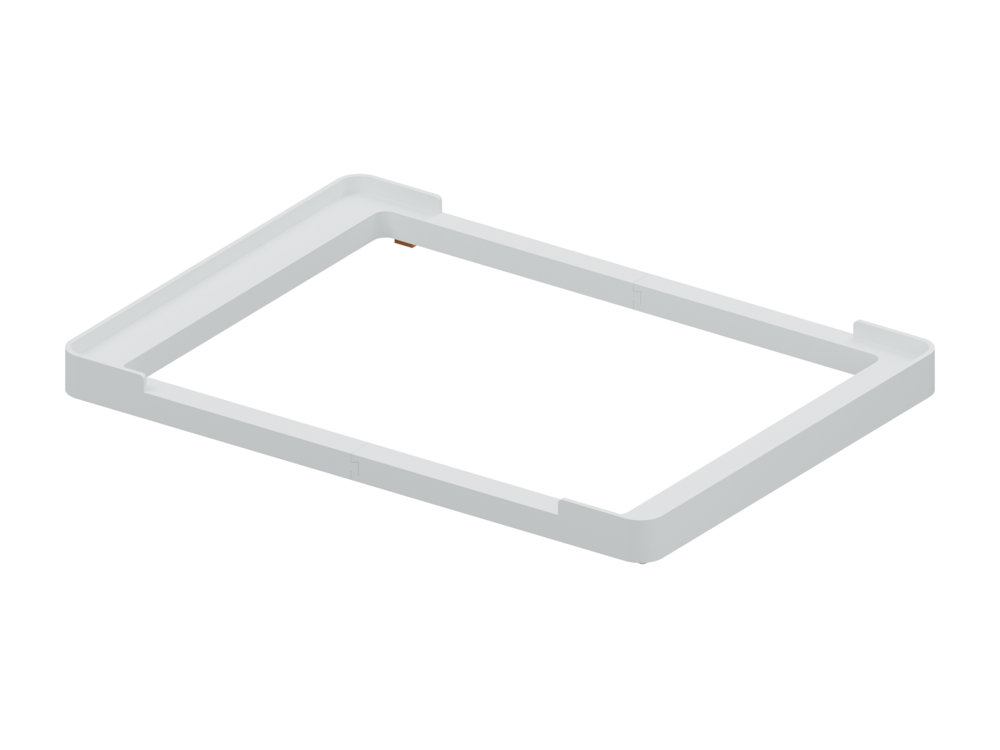

# 无 HT 顶件 / AMS-only top

两端挡边的四个外露上角已做 R3 mm 圆角，承托面和连接接口不变；打印后仍需检查毛刺。 / The four exposed upper lip ends have R3 mm rounds; bearing faces and joints are unchanged. Check printed parts for burrs.

只有 AMS 2 Pro 开口，没有 HT 阶梯孔。两片燕尾沿前后方向滑合，再一起落入端框插槽，最后插后锁片。 / One AMS 2 Pro opening, no HT cutout. Slide the two halves together along Y, lower onto the end sockets, then insert the rear keys.

编号与下表一一对应；左右以面对入口为准。爆炸图只用于辨认零件，不代表装入方向。

Match each callout to its table row. Left/right are viewed from the front. Exploded positions identify parts, not insertion directions.

[GLB](layer-assembly.glb) · [Geometry 3MF](layer-assembly-geometry.3mf) · [BOM](parts.json)

| 编号 / ID | 零件 | STL | X offset |
| --- | --- | --- | ---: |
| [NE01](top_1.stl) | 左顶件 | `top_1.stl` | 0 mm |
| [NE02](top_2.stl) | 右顶件 | `top_2.stl` | 0 mm |
| [NE03](../../common/rear-lock.stl) | 通用蝴蝶锁片 | `rear-lock.stl` | 见装配清单 / see BOM |
| [NE04](../../common/rear-lock.stl) | 通用蝴蝶锁片 | `rear-lock.stl` | 见装配清单 / see BOM |

右端框在 399 mm 装配中向左移动 96 mm。每道层缝左右各装一片相同的蝴蝶锁片，可直接平放补打。[通用锁片 STL](../../common/rear-lock.stl)

The compact assembly moves the right end frame 96 mm to the left. Print two copies of the same flat bowtie for each seam. The 3MF in this folder shows the assembled layer.
