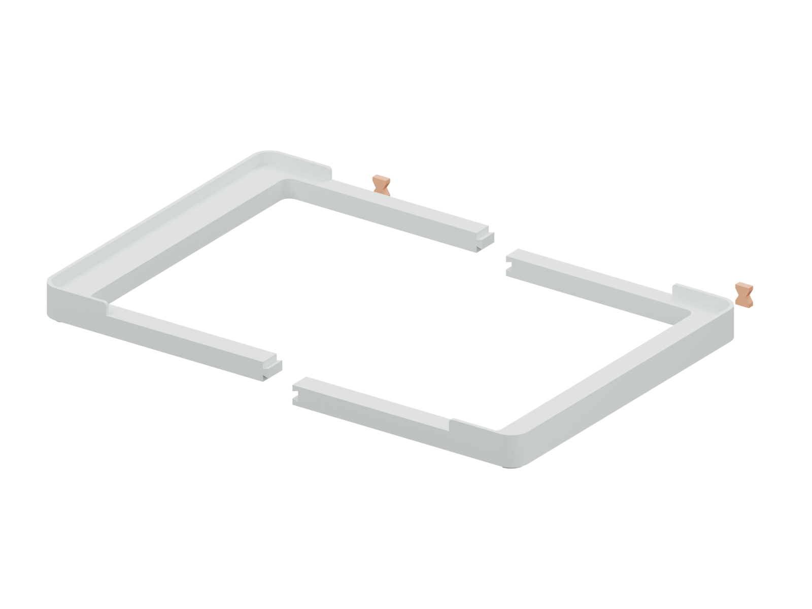

# 无 HT 顶件 / AMS-only top

只有 AMS 2 Pro 开口，没有 HT 阶梯孔。两片燕尾沿前后方向滑合，再一起落入端框插槽，最后插后锁片。 / One AMS 2 Pro opening, no HT cutout. Slide the two halves together along Y, lower onto the end sockets, then insert the rear keys.

[GLB](layer-assembly.glb) · [Geometry 3MF](layer-assembly-geometry.3mf) · [BOM](parts.json)

| Part | STL | X offset in this layer |
| --- | --- | ---: |
| top_1 | [Download](top_1.stl) | 0 mm |
| top_2 | [Download](top_2.stl) | 0 mm |
| lock_left | [Download](../../common/lock_left.stl) | 0 mm |
| lock_right | [Download](../../common/lock_right.stl) | -96 mm |

两端和锁片直接引用通用件。右件保持 HT 版导出坐标，在此装配中向左移动 96 mm；切片前将每件单独落到平台。3MF 是装配几何，不是打印任务。

Common ends and keys are referenced, not duplicated. Right-hand common files retain wide-set coordinates; the assembly moves them left by 96 mm. Reorient and place each part on the bed before slicing. The 3MF is assembly geometry, not a print job.
