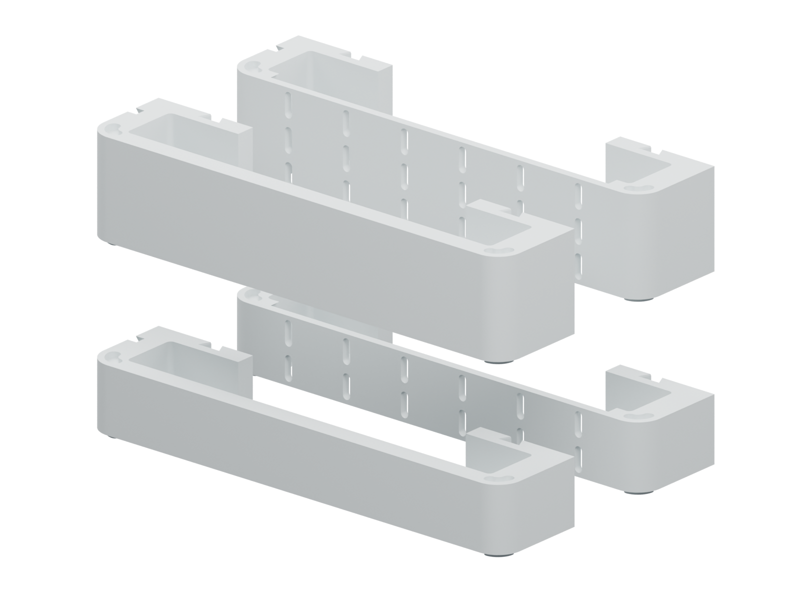
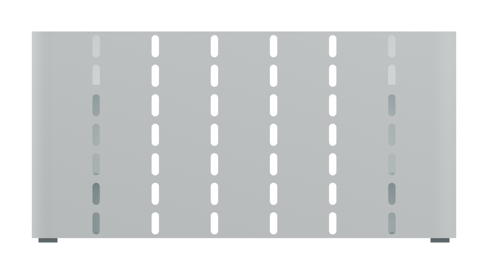

# 两端通用组件 / Common end components

40 mm / 60 mm 两种高度；相同高度用于 495 mm HT 版和 399 mm 无 HT 版。左右件不可互换。普通版与洞洞板版使用相同定位和连接接口，可以单侧替换。

Two heights, shared by both widths. Left and right parts differ; choose the matching side. Plain and pegboard variants preserve their connection geometry and can be replaced independently.

| Height | Side | Plain | Pegboard |
| --- | --- | --- | --- |
| 40 mm | left | [STL](end_left_40_plain.stl) | [STL](end_left_40_pegboard.stl) |
| 40 mm | right | [STL](end_right_40_plain.stl) | [STL](end_right_40_pegboard.stl) |
| 60 mm | left | [STL](end_left_60_plain.stl) | [STL](end_left_60_pegboard.stl) |
| 60 mm | right | [STL](end_right_60_plain.stl) | [STL](end_right_60_pegboard.stl) |

[Left rear key](lock_left.stl) · [Right rear key](lock_right.stl) · [Fit coupon](pegboard_fit_coupon.stl) · [Pegboard end GLB](pegboard-end.glb) · [Mixed-height stack GLB](straight-grid-stack.glb)

## 直列孔阵 / Straight-grid hole layout

| Feature | Nominal size |
| --- | --- |
| Vertical slot | 5 × 15 mm, R2.5 |
| Panel thickness | 5 mm |
| Horizontal / vertical pitch | 40 / 20 mm |
| Row offset | 0 mm; all columns aligned |
| Clear space behind each slot | At least 20 mm |
| 40 mm end | 12 slots, two rows; 2.5 mm top/bottom slot margins |
| 60 mm end | 18 slots, three rows; 2.5 mm top/bottom slot margins |
| Fit coupon | 80 × 80 × 5 mm; 2 columns × 3 aligned rows |

图中从下到上为 40 + 60 + 40 mm。两种层高均为 20 mm 的整数倍，首末排孔中心距层边均为 10 mm，因此任意换序或重复堆叠都能保持同列对齐、跨缝孔距 20 mm。四角、底脚、燕尾和后锁片连接区保持不变。

Bottom to top: 40 + 60 + 40 mm. Both heights are multiples of 20 mm, with the first and last row centres 10 mm from each edge. Any ordering or repetition keeps columns aligned and row spacing at 20 mm across seams. Corner feet, dovetails and rear-key interfaces are unchanged.

这是自定义直列孔阵，保留 5 × 15 mm 长圆孔，但不承诺完整兼容 SKÅDIS。先打印新版试配板，检查实际挂钩的插入、下挂、卸出和板厚配合。孔阵连续不代表跨缝挂载或承重已验证；挂件仍应固定在单个端框内。

This is a custom straight grid with 5 × 15 mm obround holes, not a claim of full SKÅDIS compatibility. Print the updated coupon and test insertion, seating, removal and panel fit. Grid continuity does not validate cross-seam mounting or payload; keep attachments within one end frame.

## Fitting / 安装

1. Remove devices, empty drawers and take off upper layers. / 移走设备、清空抽屉，拆下上层。
2. Withdraw rear keys and lift the middle out of the end dovetails. / 抽出后锁片，从上方提出中段。
3. Replace the selected end with the matching height and side; plain and pegboard can be mixed. / 换上同高度、同侧洞洞板端框，可左右混用普通版。
4. Lower the middle and upper layers back into place; reinstall rear keys. / 依次放回中段及上层，插回锁片。

Rear keys are removable, not captive. Keep rear access clear. STL coordinates match the wide set; compact assemblies translate right-hand files by −96 mm on X. Reorient each part before slicing; exported geometry is not a sliced print job.

端框是结构件。新洞洞板件已通过 PETG/FDM 通用规则检查（0.4 mm 喷嘴、0.2 mm 层高），但仍需支撑／桥接处理。实物强度、挂钩及设备适配尚未验收。
