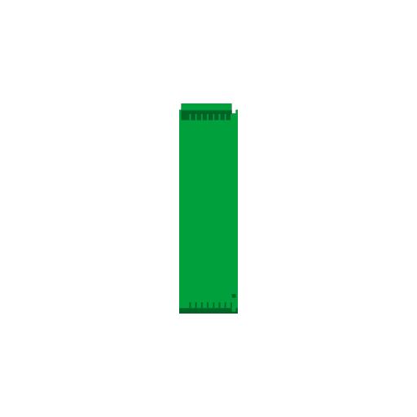
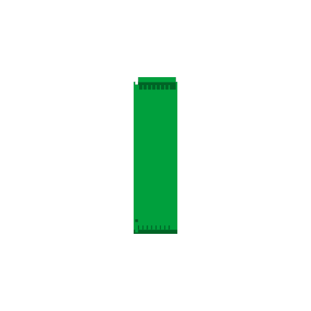
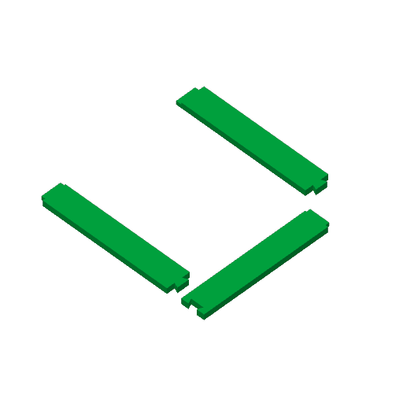
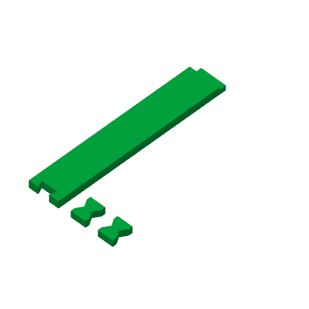

# ams2pro/8-slot-plate-layer

Status: **sliced_not_printed**

X2D · 0.4 mm · PETG Basic · Textured PEI · 0.20 mm

端框：普通 / Ends: plain

尚未实物试装、测试承重或上传 MakerWorld。 / Not physically validated or published to MakerWorld.

[打开摆盘工程 / Open project](x2d-04-petg.3mf)

预计 / Estimate: 29.4 h · 723.0 g PETG

| Plate | Parts | Preview |
| --- | --- | --- |
| 1 | 01 NB01 |  |
| 2 | 02 NB02 |  |
| 3 | 03 NB03 |  |
| 4 | 04 NB04 |  |
| 5 | 05 NB05, NB06, NB07 |  |
| 6 | 06 NB08, NB09, NB10 |  |
