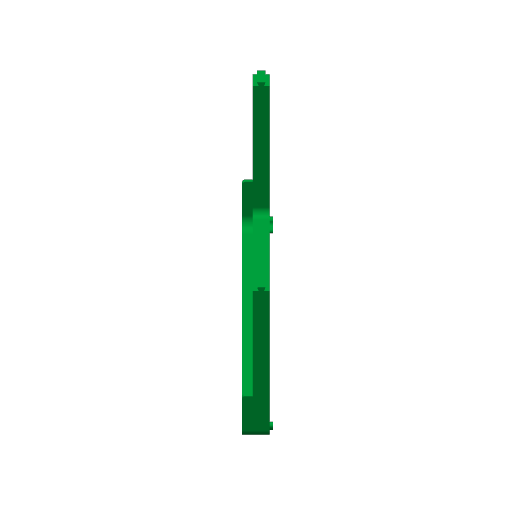
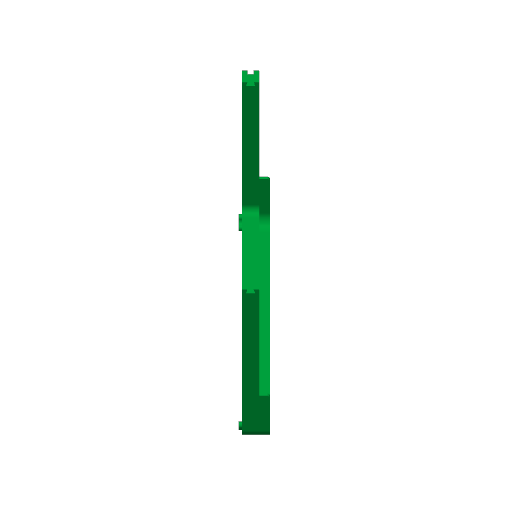

# ams2pro/device-top

Status: **sliced_not_printed**

X2D · 0.4 mm · PETG Basic · Textured PEI · 0.20 mm

端框：普通 / Ends: plain

尚未实物试装、测试承重或上传 MakerWorld。 / Not physically validated or published to MakerWorld.

[打开摆盘工程 / Open project](x2d-04-petg.3mf)

预计 / Estimate: 11.5 h · 269.3 g PETG

| Plate | Parts | Preview |
| --- | --- | --- |
| 1 | 01 NE01 |  |
| 2 | 02 NE02 |  |
| 3 | 03 NE03, NE04 |  |
