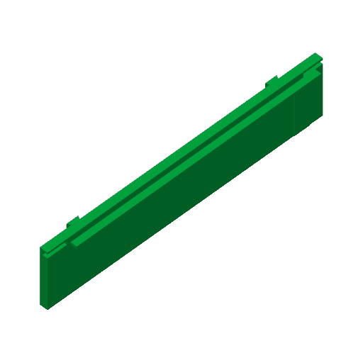
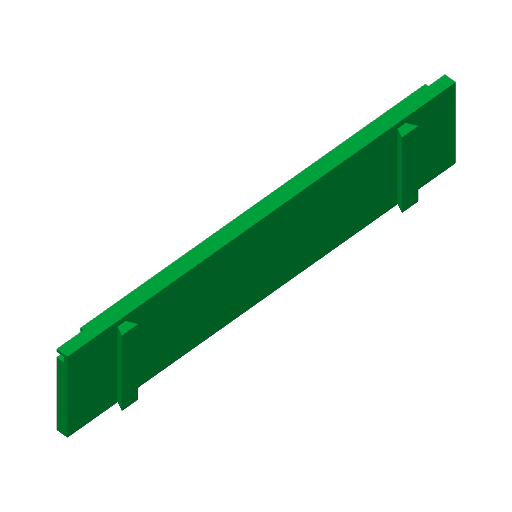
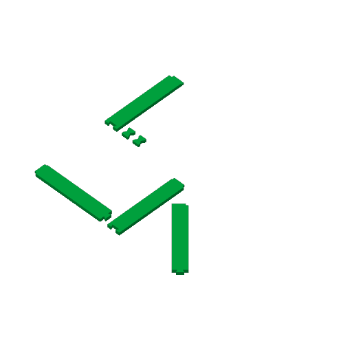
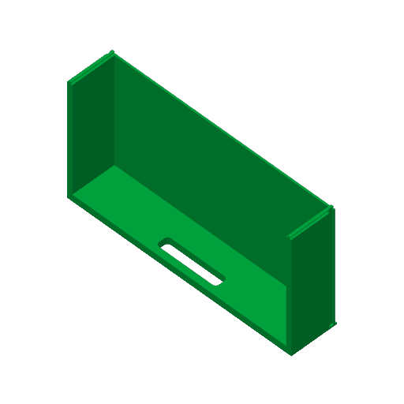
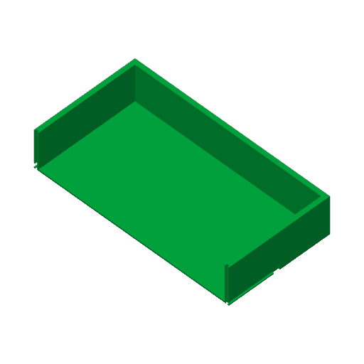

# ams2pro/1-drawer-layer

Status: **sliced_not_printed**

H2S · 0.4 mm · PETG Basic · Textured PEI · 0.20 mm

端框：普通 / Ends: plain

尚未实物试装、测试承重或上传 MakerWorld。 / Not physically validated or published to MakerWorld.

[打开摆盘工程 / Open project](h2s-04-petg.3mf)

预计 / Estimate: 31.6 h · 1053.0 g PETG

| Plate | Parts | Preview |
| --- | --- | --- |
| 1 | 01 NC01 |  |
| 2 | 02 NC02 |  |
| 3 | 03 NC03 |  |
| 4 | 04 NC04 |  |
| 5 | 05 NC05, NC06, NC07, NC08, NC11, NC12 |  |
| 6 | 06 NC09 |  |
| 7 | 07 NC10 |  |
