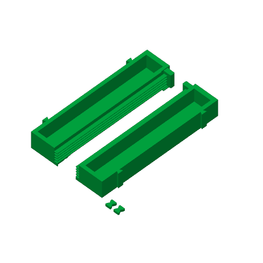
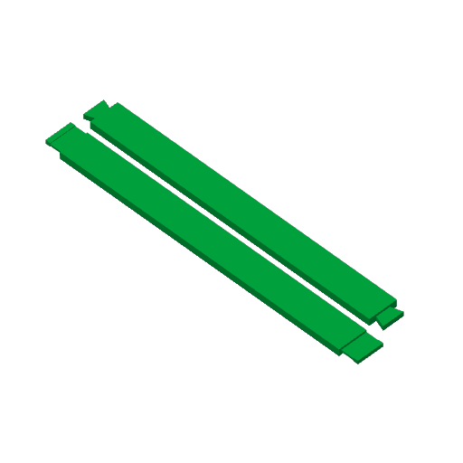
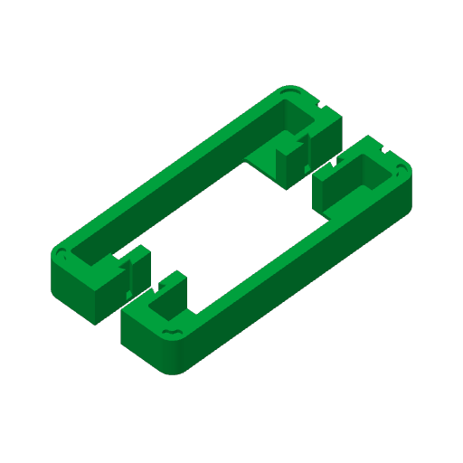

# ams2pro-ht/01-five-slot-plate-layer

Status: **sliced_not_printed**

H2C · 0.4 mm · PETG Basic · Textured PEI · 0.20 mm

端框：普通 / Ends: plain

尚未实物试装、测试承重或上传 MakerWorld。 / Not physically validated or published to MakerWorld.

摆盘切片对比 / Sliced layout comparison:

| Metric | Before | After |
| --- | ---: | ---: |
| Plates | 7 | 3 |
| Estimated hours | 28.495 | 28.243 |
| PETG g | 793.8 | 806.58 |
| Support extrusion g | 63.613 | 59.013 |

支撑重量按 G-code 挤出量估算；未实物验证。 / Support mass is estimated from G-code extrusion; not physically validated.

[打开摆盘工程 / Open project](h2c-04-petg.3mf)

预计 / Estimate: 28.2 h · 806.6 g PETG

| Plate | Parts | Preview |
| --- | --- | --- |
| 1 | 01 A01, A02, KEY-left, KEY-right |  |
| 2 | 02 A03, A04 |  |
| 3 | 03 A05, A06 |  |
