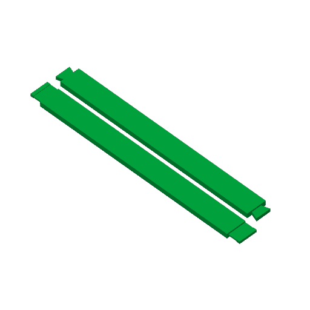
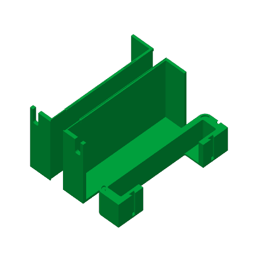
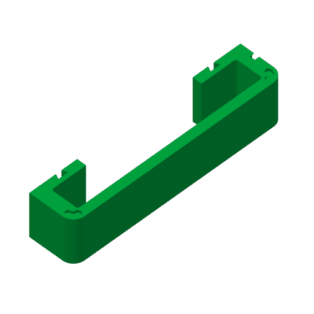

# ams2pro-ht/03-single-drawer-layer

Status: **sliced_not_printed**

H2C · 0.4 mm · PETG Basic · Textured PEI · 0.20 mm

端框：普通 / Ends: plain

尚未实物试装、测试承重或上传 MakerWorld。 / Not physically validated or published to MakerWorld.

摆盘切片对比 / Sliced layout comparison:

| Metric | Before | After |
| --- | ---: | ---: |
| Plates | 9 | 4 |
| Estimated hours | 43.344 | 35.08 |
| PETG g | 1401.61 | 1327.39 |
| Support extrusion g | 135.605 | 26.905 |

支撑重量按 G-code 挤出量估算；未实物验证。 / Support mass is estimated from G-code extrusion; not physically validated.

[打开摆盘工程 / Open project](h2c-04-petg.3mf)

预计 / Estimate: 35.1 h · 1327.4 g PETG

| Plate | Parts | Preview |
| --- | --- | --- |
| 1 | 01 C01, C02, C03, C04 |  |
| 2 | 02 C05, C06 |  |
| 3 | 03 C07, C08, C09 |  |
| 4 | 04 C10 |  |
