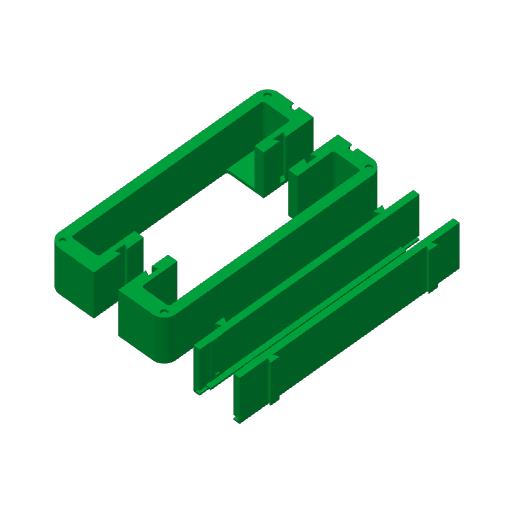
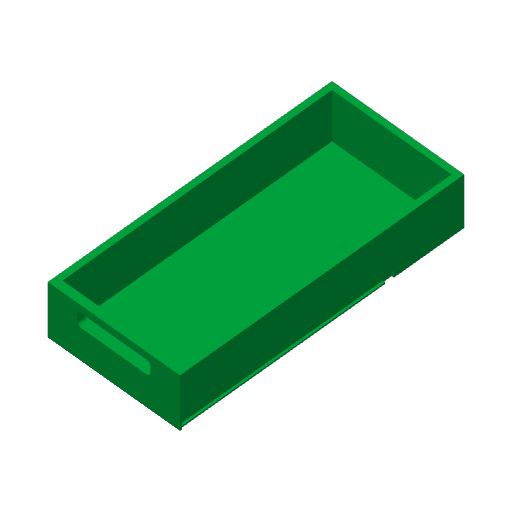

# ams2pro/2-drawer-layer

Status: **sliced_not_printed**

H2C · 0.4 mm · PETG Basic · Textured PEI · 0.20 mm

普通端框 / Plain ends

尚未实物试装、测试承重或上传 MakerWorld。 / Not physically validated or published to MakerWorld.

每道接缝左右各用一片，所有层通用。 / Use two identical bowties per seam, one on each side. [通用尾锁 / Rear key STL](../../../../models/common/rear-lock.stl)

摆盘切片对比 / Sliced layout comparison:

| Metric | Before | After |
| --- | ---: | ---: |
| Plates | 8 | 4 |
| Estimated hours | 51.765 | 43.209 |
| PETG g | 1402.3 | 1363.88 |
| Support extrusion g | 241.206 | 101.581 |

支撑重量按 G-code 挤出量估算；未实物验证。 / Support mass is estimated from G-code extrusion; not physically validated.

[打开摆盘工程 / Open project](h2c-04-petg.3mf)

预计 / Estimate: 43.2 h · 1363.9 g PETG

| Plate | Parts | Preview |
| --- | --- | --- |
| 1 | 01 ND01, ND02, ND03, ND04 |  |
| 2 | 02 ND05, ND06, ND07, ND08, ND09, ND12, ND13 |  |
| 3 | 03 ND10 |  |
| 4 | 04 ND11 |  |
