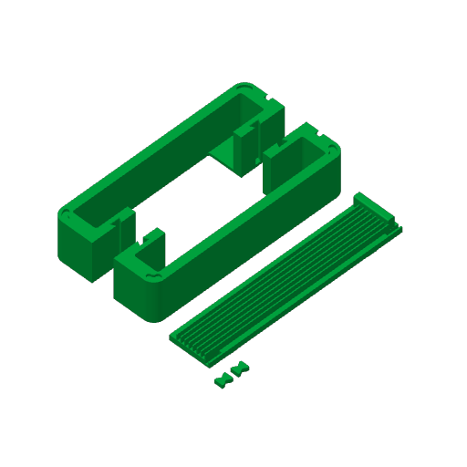

# ams2pro/8-slot-plate-layer

Status: **sliced_not_printed**

H2C · 0.4 mm · PETG Basic · Textured PEI · 0.20 mm

端框：普通 / Ends: plain

尚未实物试装、测试承重或上传 MakerWorld。 / Not physically validated or published to MakerWorld.

摆盘切片对比 / Sliced layout comparison:

| Metric | Before | After |
| --- | ---: | ---: |
| Plates | 5 | 2 |
| Estimated hours | 30.218 | 29.023 |
| PETG g | 800.56 | 770.86 |
| Support extrusion g | 104.607 | 80.674 |

支撑重量按 G-code 挤出量估算；未实物验证。 / Support mass is estimated from G-code extrusion; not physically validated.

[打开摆盘工程 / Open project](h2c-04-petg.3mf)

预计 / Estimate: 29.0 h · 770.9 g PETG

| Plate | Parts | Preview |
| --- | --- | --- |
| 1 | 01 NB01, NB02, NB03, NB09, NB10 |  |
| 2 | 02 NB04, NB05, NB06, NB07, NB08 |  |
