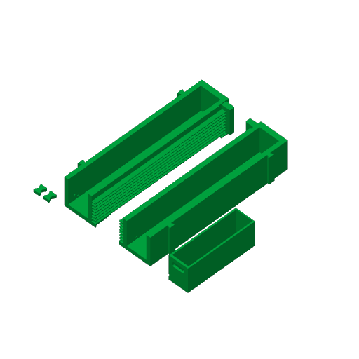
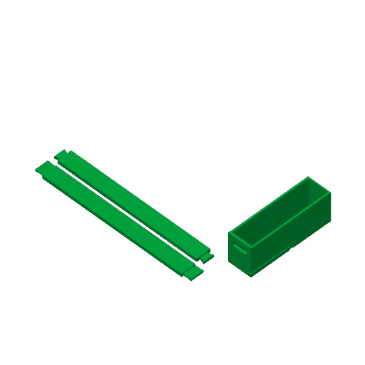
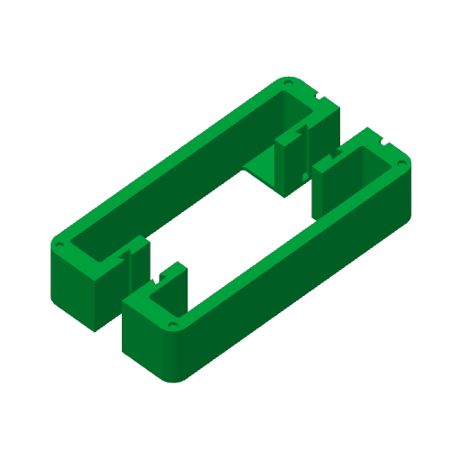

# ams2pro-ht/02-eight-slot-plate-layer

Status: **sliced_not_printed**

H2S · 0.4 mm · PETG Basic · Textured PEI · 0.20 mm

普通端框 / Plain ends

尚未实物试装、测试承重或上传 MakerWorld。 / Not physically validated or published to MakerWorld.

每道接缝左右各用一片，所有层通用。 / Use two identical bowties per seam, one on each side. [通用尾锁 / Rear key STL](../../../../models/common/rear-lock.stl)

摆盘切片对比 / Sliced layout comparison:

| Metric | Before | After |
| --- | ---: | ---: |
| Plates | 7 | 3 |
| Estimated hours | 40.766 | 39.932 |
| PETG g | 1199.31 | 1222.64 |
| Support extrusion g | 95.756 | 81.745 |

支撑重量按 G-code 挤出量估算；未实物验证。 / Support mass is estimated from G-code extrusion; not physically validated.

[打开摆盘工程 / Open project](h2s-04-petg.3mf)

预计 / Estimate: 39.9 h · 1222.6 g PETG

| Plate | Parts | Preview |
| --- | --- | --- |
| 1 | 01 B01, B02, B03, B04, B09 |  |
| 2 | 02 B05, B06, B10 |  |
| 3 | 03 B07, B08 |  |
