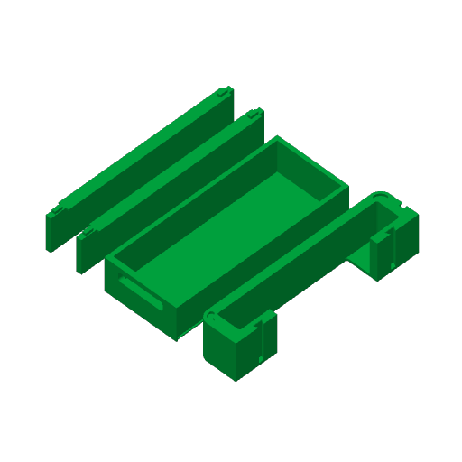
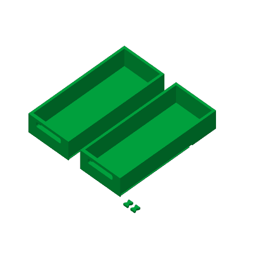
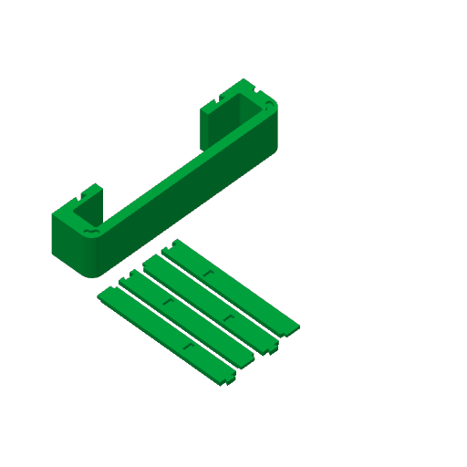
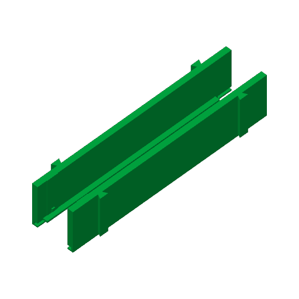

# ams2pro-ht/05-triple-drawer-layer

Status: **sliced_not_printed**

H2S · 0.4 mm · PETG Basic · Textured PEI · 0.20 mm

端框：普通 / Ends: plain

尚未实物试装、测试承重或上传 MakerWorld。 / Not physically validated or published to MakerWorld.

摆盘切片对比 / Sliced layout comparison:

| Metric | Before | After |
| --- | ---: | ---: |
| Plates | 11 | 4 |
| Estimated hours | 63.563 | 53.99 |
| PETG g | 1710.05 | 1711.32 |
| Support extrusion g | 293.049 | 143.064 |

支撑重量按 G-code 挤出量估算；未实物验证。 / Support mass is estimated from G-code extrusion; not physically validated.

[打开摆盘工程 / Open project](h2s-04-petg.3mf)

预计 / Estimate: 54.0 h · 1711.3 g PETG

| Plate | Parts | Preview |
| --- | --- | --- |
| 1 | 01 E01, E02, E03, E06 |  |
| 2 | 02 E04, E05, E12, E13 |  |
| 3 | 03 E07, E08, E09, E10, E11 |  |
| 4 | 04 E14, E15 |  |
