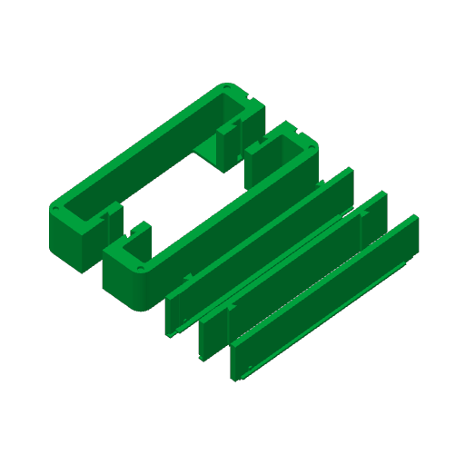
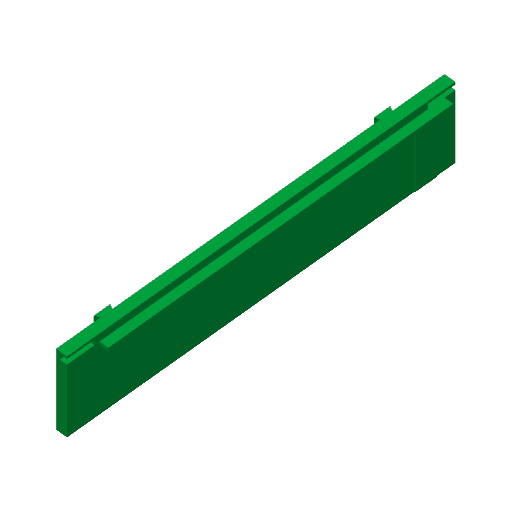

# ams2pro/2-drawer-layer

Status: **sliced_not_printed**

H2S · 0.4 mm · PETG Basic · Textured PEI · 0.20 mm

普通端框 / Plain ends

尚未实物试装、测试承重或上传 MakerWorld。 / Not physically validated or published to MakerWorld.

每道接缝左右各用一片，所有层通用。 / Use two identical bowties per seam, one on each side. [通用尾锁 / Rear key STL](../../../../models/common/rear-lock.stl)

摆盘切片对比 / Sliced layout comparison:

| Metric | Before | After |
| --- | ---: | ---: |
| Plates | 8 | 3 |
| Estimated hours | 50.414 | 42.077 |
| PETG g | 1373.61 | 1335.68 |
| Support extrusion g | 236.437 | 99.488 |

支撑重量按 G-code 挤出量估算；未实物验证。 / Support mass is estimated from G-code extrusion; not physically validated.

[打开摆盘工程 / Open project](h2s-04-petg.3mf)

预计 / Estimate: 42.1 h · 1335.7 g PETG

| Plate | Parts | Preview |
| --- | --- | --- |
| 1 | 01 ND01, ND02, ND03, ND04, ND05 |  |
| 2 | 02 ND06, ND07, ND08, ND09, ND12, ND13 |  |
| 3 | 03 ND10, ND11 |  |
