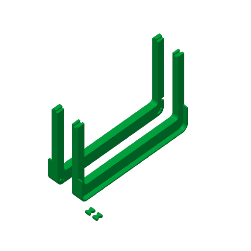

# ams2pro/device-top

Status: **sliced_not_printed**

H2S · 0.4 mm · PETG Basic · Textured PEI · 0.20 mm

端框：普通 / Ends: plain

尚未实物试装、测试承重或上传 MakerWorld。 / Not physically validated or published to MakerWorld.

摆盘切片对比 / Sliced layout comparison:

| Metric | Before | After |
| --- | ---: | ---: |
| Plates | 3 | 1 |
| Estimated hours | 11.348 | 9.044 |
| PETG g | 269.37 | 269.39 |
| Support extrusion g | 1.655 | 1.547 |

支撑重量按 G-code 挤出量估算；未实物验证。 / Support mass is estimated from G-code extrusion; not physically validated.

[打开摆盘工程 / Open project](h2s-04-petg.3mf)

预计 / Estimate: 9.0 h · 269.4 g PETG

| Plate | Parts | Preview |
| --- | --- | --- |
| 1 | 01 NE01, NE02, NE03, NE04 |  |
