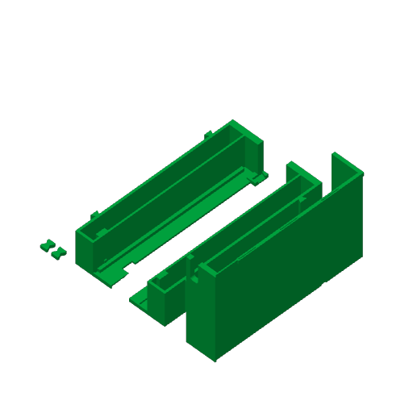
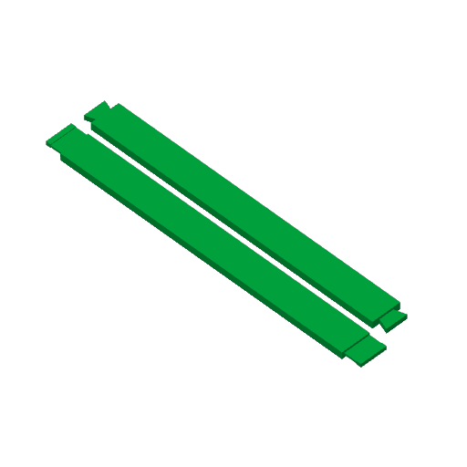
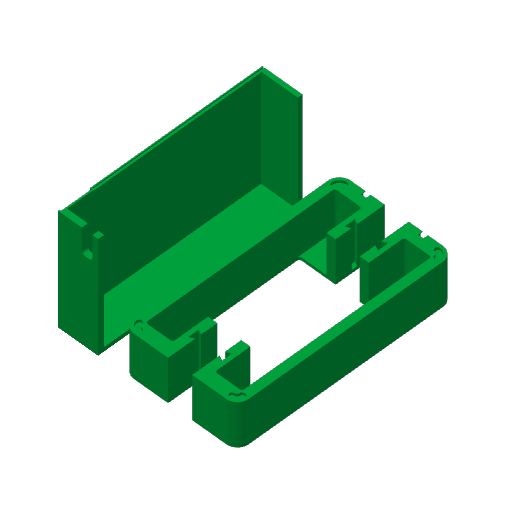

# ams2pro-ht/03-single-drawer-layer

Status: **sliced_not_printed**

H3C · 0.4 mm · PETG Basic · Textured PEI · 0.20 mm

端框：普通 / Ends: plain

尚未实物试装、测试承重或上传 MakerWorld。 / Not physically validated or published to MakerWorld.

摆盘切片对比 / Sliced layout comparison:

| Metric | Before | After |
| --- | ---: | ---: |
| Plates | 9 | 3 |
| Estimated hours | 36.169 | 29.786 |
| PETG g | 1371.11 | 1299.95 |
| Support extrusion g | 131.179 | 26.352 |

支撑重量按 G-code 挤出量估算；未实物验证。 / Support mass is estimated from G-code extrusion; not physically validated.

[打开摆盘工程 / Open project](h3c-04-petg.3mf)

预计 / Estimate: 29.8 h · 1299.9 g PETG

| Plate | Parts | Preview |
| --- | --- | --- |
| 1 | 01 C01, C02, C03, C04, C07 |  |
| 2 | 02 C05, C06 |  |
| 3 | 03 C08, C09, C10 |  |
