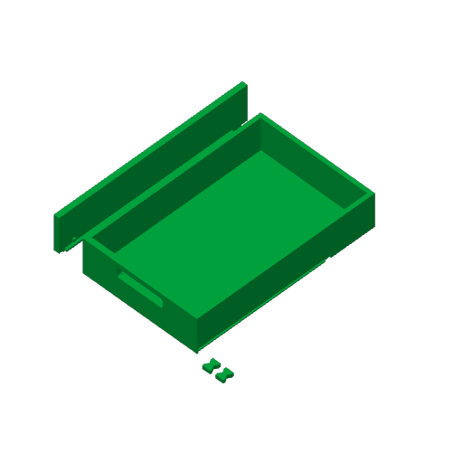
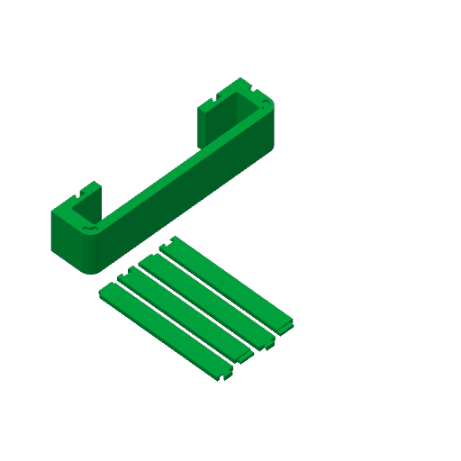

# ams2pro-ht/04-double-drawer-layer

Status: **sliced_not_printed**

H3C · 0.4 mm · PETG Basic · Textured PEI · 0.20 mm

端框：普通 / Ends: plain

尚未实物试装、测试承重或上传 MakerWorld。 / Not physically validated or published to MakerWorld.

摆盘切片对比 / Sliced layout comparison:

| Metric | Before | After |
| --- | ---: | ---: |
| Plates | 9 | 4 |
| Estimated hours | 45.975 | 40.571 |
| PETG g | 1550.27 | 1474.76 |
| Support extrusion g | 290.612 | 120.645 |

支撑重量按 G-code 挤出量估算；未实物验证。 / Support mass is estimated from G-code extrusion; not physically validated.

[打开摆盘工程 / Open project](h3c-04-petg.3mf)

预计 / Estimate: 40.6 h · 1474.8 g PETG

| Plate | Parts | Preview |
| --- | --- | --- |
| 1 | 01 D01, D02, D10, D11 |  |
| 2 | 02 D03, D04 |  |
| 3 | 03 D05, D06, D07, D08, D09 |  |
| 4 | 04 D12, D13 |  |
