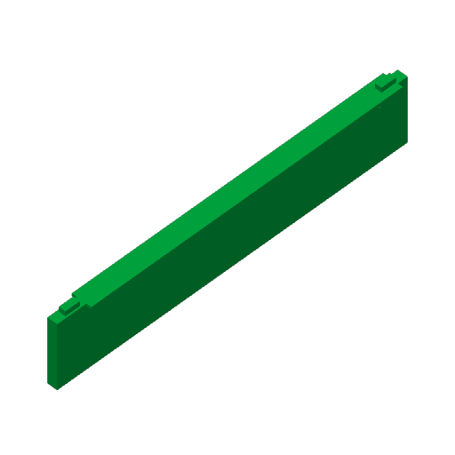
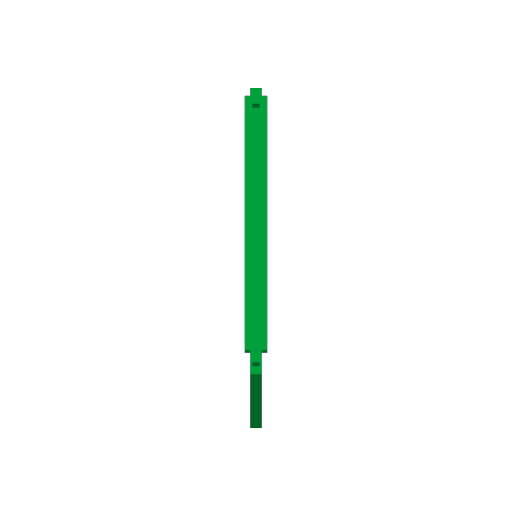
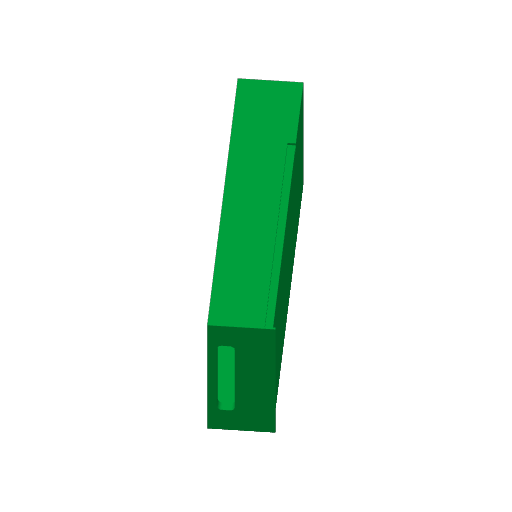
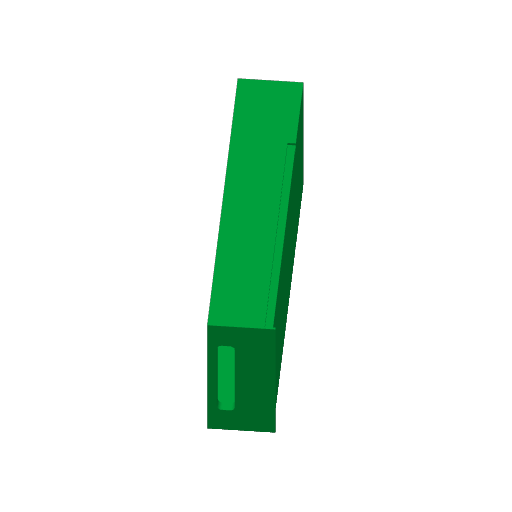
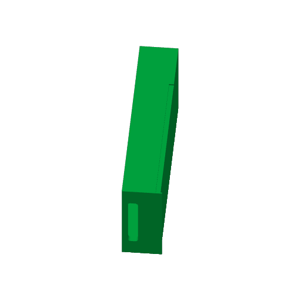
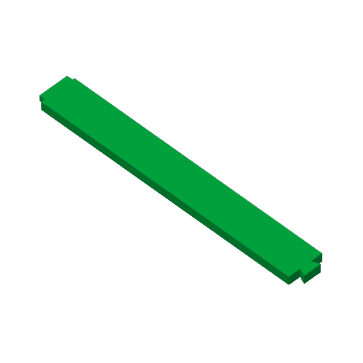
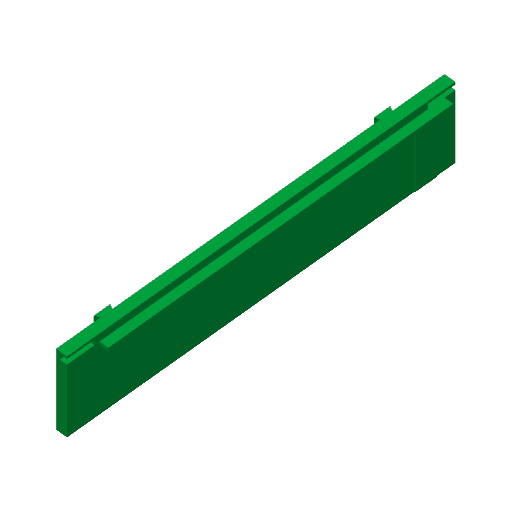
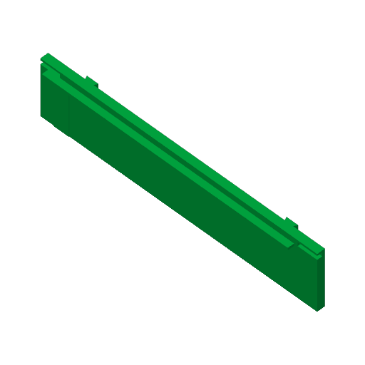

# ams2pro-ht/05-triple-drawer-layer

Status: **sliced_not_printed**

H3C · 0.4 mm · PETG Basic · Textured PEI · 0.20 mm

端框：普通 / Ends: plain

尚未实物试装、测试承重或上传 MakerWorld。 / Not physically validated or published to MakerWorld.

[打开摆盘工程 / Open project](h3c-04-petg.3mf)

预计 / Estimate: 53.7 h · 1714.2 g PETG

| Plate | Parts | Preview |
| --- | --- | --- |
| 1 | 01 E01 |  |
| 2 | 02 E02 |  |
| 3 | 03 E03 |  |
| 4 | 04 E04 |  |
| 5 | 05 E05 |  |
| 6 | 06 E06 |  |
| 7 | 07 E07 |  |
| 8 | 08 E08 |  |
| 9 | 09 E09, E10, E11, E12, E13 |  |
| 10 | 10 E14 |  |
| 11 | 11 E15 |  |
