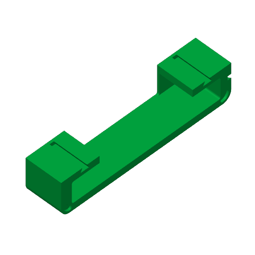

# ams2pro/1-drawer-layer

Status: **sliced_not_printed**

H3C · 0.4 mm · PETG Basic · Textured PEI · 0.20 mm

普通端框 / Plain ends

尚未实物试装、测试承重或上传 MakerWorld。 / Not physically validated or published to MakerWorld.

每道接缝左右各用一片，所有层通用。 / Use two identical bowties per seam, one on each side. [通用尾锁 / Rear key STL](../../../../models/common/rear-lock.stl)

摆盘切片对比 / Sliced layout comparison:

| Metric | Before | After |
| --- | ---: | ---: |
| Plates | 7 | 2 |
| Estimated hours | 27.102 | 25.914 |
| PETG g | 1053.01 | 1064.06 |
| Support extrusion g | 50.396 | 29.809 |

支撑重量按 G-code 挤出量估算；未实物验证。 / Support mass is estimated from G-code extrusion; not physically validated.

[打开摆盘工程 / Open project](h3c-04-petg.3mf)

预计 / Estimate: 25.9 h · 1064.1 g PETG

| Plate | Parts | Preview |
| --- | --- | --- |
| 1 | 01 NC01, NC02, NC03, NC04, NC11, NC12 |  |
| 2 | 02 NC05, NC06, NC07, NC08, NC09, NC10 |  |
