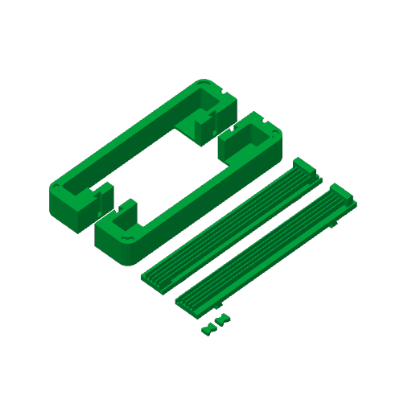
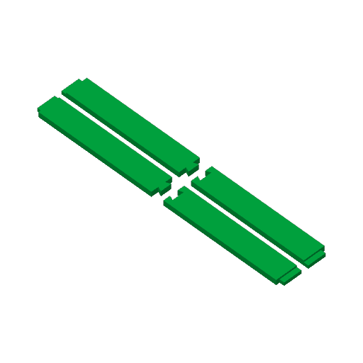

# ams2pro/5-slot-plate-layer

Status: **sliced_not_printed**

H3C · 0.4 mm · PETG Basic · Textured PEI · 0.20 mm

端框：普通 / Ends: plain

尚未实物试装、测试承重或上传 MakerWorld。 / Not physically validated or published to MakerWorld.

摆盘切片对比 / Sliced layout comparison:

| Metric | Before | After |
| --- | ---: | ---: |
| Plates | 5 | 2 |
| Estimated hours | 20.971 | 17.418 |
| PETG g | 572.46 | 540.36 |
| Support extrusion g | 79.077 | 60.523 |

支撑重量按 G-code 挤出量估算；未实物验证。 / Support mass is estimated from G-code extrusion; not physically validated.

[打开摆盘工程 / Open project](h3c-04-petg.3mf)

预计 / Estimate: 17.4 h · 540.4 g PETG

| Plate | Parts | Preview |
| --- | --- | --- |
| 1 | 01 NA01, NA02, NA03, NA04, KEY-left, KEY-right |  |
| 2 | 02 NA05, NA06, NA07, NA08 |  |
