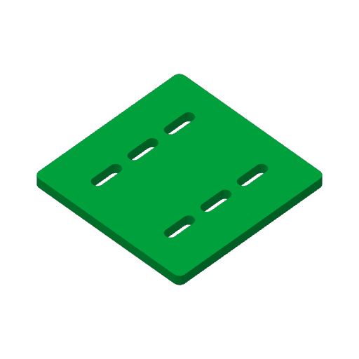

# fit-check/pegboard

Status: **sliced_not_printed**

H3C · 0.4 mm · PETG Basic · Textured PEI · 0.20 mm

试配小件 / Fit specimens

尚未实物试装、测试承重或上传 MakerWorld。 / Not physically validated or published to MakerWorld.

摆盘切片对比 / Sliced layout comparison:

| Metric | Before | After |
| --- | ---: | ---: |
| Plates | 1 | 1 |
| Estimated hours | 0.524 | 0.524 |
| PETG g | 19.93 | 19.93 |
| Support extrusion g | 0.0 | 0.0 |

支撑重量按 G-code 挤出量估算；未实物验证。 / Support mass is estimated from G-code extrusion; not physically validated.

[打开摆盘工程 / Open project](h3c-04-petg.3mf)

预计 / Estimate: 0.5 h · 19.9 g PETG

| Plate | Parts | Preview |
| --- | --- | --- |
| 1 | 01 FIT01 |  |
