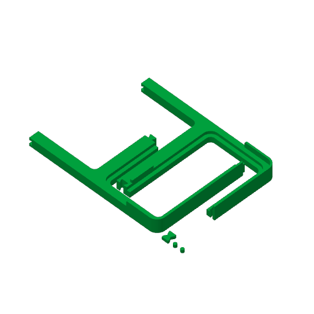

# replacement/ht-top-right

Status: **sliced_not_printed**

H3C · 0.4 mm · PETG Basic · Textured PEI · 0.20 mm

HT 侧替换件 / HT-side replacement

尚未实物试装、测试承重或上传 MakerWorld。 / Not physically validated or published to MakerWorld.

旧 F02 的 PETG Matte 实打遇到支撑难拆，层间定位脚和圆角有缝。请选择与耗材匹配的工程或预设。

The original matte PETG print had stuck supports and gaps at the stacking foot and corners. Choose the project or filament preset for your spool.

每道接缝左右各用一片，所有层通用。 / Use two identical bowties per seam, one on each side. [通用尾锁 / Rear key STL](../../../../models/common/rear-lock.stl)

F02、F05 平放打印，F06、F07 为相同的圆柱销，任一端贴板。将前后段的两处燕尾竖直合拢，再把圆销放入下层右侧前后孔。F03、F04 都是同一片蝴蝶锁片。右侧用其中一片，大面贴板打印，装好后从后面水平推入 F05。

Print F02 and F05 flat and the identical F06 and F07 dowels on end. Join both dovetails vertically and place the dowels in the holes of the lower frame. F03 and F04 are identical bowties. Print either on its broad face and slide it into F05 from the rear.

摆盘切片对比 / Sliced layout comparison:

| Metric | Before | After |
| --- | ---: | ---: |
| Plates | 1 | 1 |
| Estimated hours | 6.258 | 4.114 |
| PETG g | 178.94 | 162.18 |
| Support extrusion g | 22.981 | 0.584 |

支撑重量按 G-code 挤出量估算；未实物验证。 / Support mass is estimated from G-code extrusion; not physically validated.

[打开摆盘工程 / Open project](h3c-04-petg.3mf)

预计 / Estimate: 4.1 h · 162.2 g PETG

| Plate | Parts | Preview |
| --- | --- | --- |
| 1 | 01 F02, F04, F05, F06, F07 |  |
