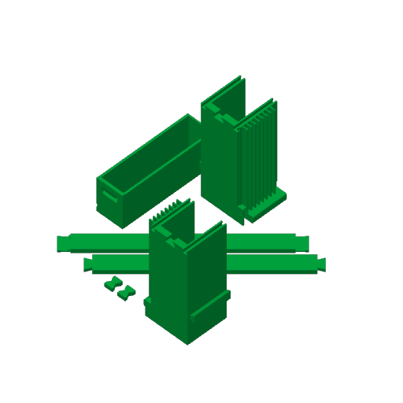
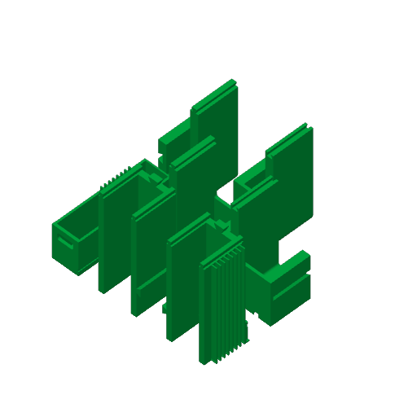

# ams2pro-ht/02-eight-slot-plate-layer

Status: **sliced_not_printed**

P2S · 0.4 mm · PETG Basic · Textured PEI · 0.20 mm

普通端框 / Plain ends

尚未实物试装、测试承重或上传 MakerWorld。 / Not physically validated or published to MakerWorld.

[PETG Matte · 打开工程 / Open project](p2s-04-petg-matte.3mf)

Matte · 2 盘 / plates · 36.64 h · 1324.50 g · 支撑 / support 23.32 g

同编号的 a 和 b 竖直合拢。J 是整根横梁。 / Lower matching a/b sections together. J denotes a one-piece beam.

每道接缝左右各用一片，所有层通用。 / Use two identical bowties per seam, one on each side. [通用尾锁 / Rear key STL](../../../../models/common/rear-lock.stl)

摆盘切片对比 / Sliced layout comparison:

| Metric | Before | After |
| --- | ---: | ---: |
| Plates | 6 | 2 |
| Estimated hours | 48.135 | 34.858 |
| PETG g | 1255.85 | 1208.49 |
| Support extrusion g | 172.766 | 21.277 |

支撑重量按 G-code 挤出量估算；未实物验证。 / Support mass is estimated from G-code extrusion; not physically validated.

[打开摆盘工程 / Open project](p2s-04-petg.3mf)

预计 / Estimate: 34.9 h · 1208.5 g PETG

| Plate | Parts | Preview |
| --- | --- | --- |
| 1 | 01 B05, B06, B09, B04b, B03b, B01, B02 |  |
| 2 | 02 B10, B04a, B03a, B07a, B07b, B08a, B08b |  |
