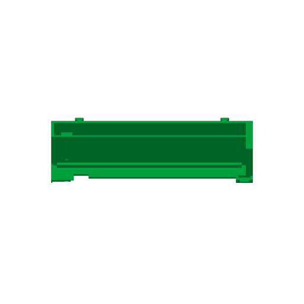
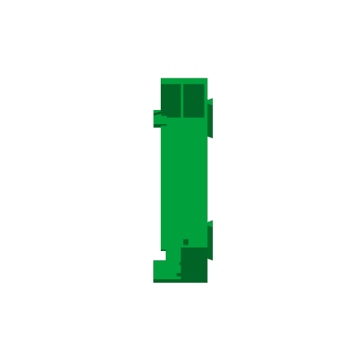
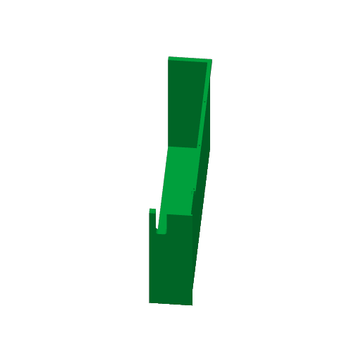
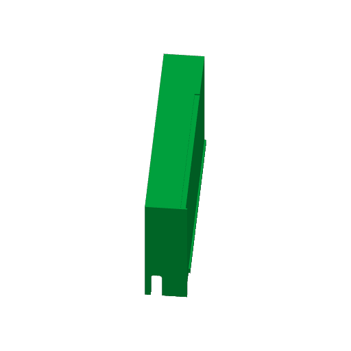

# ams2pro-ht/03-single-drawer-layer

Status: **sliced_not_printed**

P2S · 0.4 mm · PETG Basic · Textured PEI · 0.20 mm

端框：普通 / Ends: plain

尚未实物试装、测试承重或上传 MakerWorld。 / Not physically validated or published to MakerWorld.

[打开摆盘工程 / Open project](p2s-04-petg.3mf)

预计 / Estimate: 43.5 h · 1374.3 g PETG

| Plate | Parts | Preview |
| --- | --- | --- |
| 1 | 01 C01, C02 |  |
| 2 | 02 C03 |  |
| 3 | 03 C04 |  |
| 4 | 04 C05 |  |
| 5 | 05 C06 |  |
| 6 | 06 C07 |  |
| 7 | 07 C08 |  |
| 8 | 08 C09 |  |
| 9 | 09 C10 |  |
